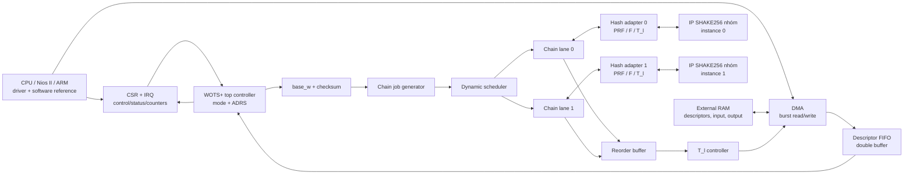

# Kế hoạch chính thức: đồ án SoC và bài báo FIPS 205 SLH-DSA

> **Trạng thái:** Tài liệu duy nhất dùng để triển khai.  
> **Cập nhật:** 26/09/2026.  
> **Thời gian:** khoảng 10 tuần cho đồ án SoC và tối đa 6 tuần tiếp theo để hoàn thiện bản thảo bài báo.  
> **Nguyên tắc:** mọi thay đổi phạm vi sau này phải được cập nhật ngay trong file này, không tạo thêm file kế hoạch cạnh tranh.

## 1. Quyết định cuối cùng

### 1.1 Đồ án môn học

Tên đề tài đề xuất:

> **Thiết kế WOTS+ Accelerator đa lane cho FIPS 205 SLH-DSA-SHAKE-128f sử dụng DMA và RAM ngoài**

Sản phẩm chính là một IP WOTS+ viết bằng Verilog/SystemVerilog, hỗ trợ:

- `wots_pkGen`;
- `wots_sign`;
- `wots_pkFromSig`;
- chuyển message sang base-16 và tính checksum;
- quản lý địa chỉ `ADRS`;
- điều khiển các Winternitz chain;
- sắp xếp kết quả hoàn thành không đồng thời;
- nén WOTS+ public key bằng `T_l`;
- tối thiểu hai hash lane thực sự hoạt động song song;
- pipeline cấp hệ thống;
- DMA, RAM ngoài, CSR, interrupt và performance counter.

Bạn **được phép dùng IP ngoài trong đồ án**, bao gồm IP SHAKE256/Keccak do nhóm nghiên cứu đã phát triển và trưởng nhóm đang dùng. Chọn chính IP này làm hash backend cho WOTS+ Engine từ đầu; không cần xây hoặc tìm một SHAKE256 RTL khác chỉ để tách đồ án. Trong báo cáo và slide, ghi rõ nguồn, tác giả và vai trò của IP; đóng góp của bạn là WOTS+ controller, tích hợp SoC, DMA, RAM ngoài, pipeline, lập lịch và kiểm chứng. Việc dùng chung IP được phép không đồng nghĩa hai đồ án có cùng phần đóng góp.

Behavioral hash model chỉ phục vụ mô phỏng. Nó không đủ thay cho backend phần cứng nếu sản phẩm cần chạy thật trên FPGA.

### 1.2 Dự án nghiên cứu và bài báo

Sau môn, tiếp tục dùng cùng IP SHAKE256/Keccak của nhóm làm nền tảng cho hệ thống nghiên cứu. Hệ thống cuối cùng phải hỗ trợ đủ ba chức năng FIPS 205:

- KeyGen;
- Sign;
- Verify.

KeyGen là bước đầu để học và kiểm tra kiến trúc, không phải phạm vi cuối cùng. Hướng khả thi trong thời gian ngắn là **HW/SW co-design**: CPU/firmware điều phối luồng SLH-DSA hoàn chỉnh, còn phần cứng tăng tốc WOTS+, dịch vụ hash và các phần được profiling là nút thắt. Chỉ chuyển FORS, XMSS hoặc hypertree hoàn toàn sang RTL khi số liệu chứng minh cần thiết và lịch cho phép.

Không nên cam kết full-RTL cho toàn bộ KeyGen, Sign và Verify nếu chỉ bắt đầu sau khi nộp môn. Nếu nhóm bắt buộc mọi controller đều là RTL, công việc FORS/XMSS/hypertree phải được chia cho các thành viên và bắt đầu ngay trong 10 tuần làm đồ án.

### 1.3 Những phương án đã loại

- Không làm SHA-256 multi-lane chỉ để có một core riêng. Hướng này tiêu tốn thời gian ở tầng hash trong khi nhóm đã có IP SHAKE256 dùng được ngay cho đồ án và bài báo FIPS 205 SLH-DSA-SHAKE.
- Chỉ chọn SHA-256 nếu câu hỏi nghiên cứu chính thức là so sánh SLH-DSA-SHA2 với SLH-DSA-SHAKE và nhóm chấp nhận chi phí phát triển thêm.
- IP Keccak/SHAKE256 của nhóm là thành phần tái sử dụng; không trình bày phần RTL do trưởng nhóm thiết kế là đóng góp riêng của bạn.
- Không đổi sang systolic matrix accelerator. Phương án đó đáp ứng môn học nhưng không tạo tài sản tái sử dụng cho bài báo FIPS 205.
- Không hỗ trợ cả 12 parameter sets trong giai đoạn đầu. Khóa một bộ tham số để giảm rủi ro.
- Không mặc định AXI, Avalon hay loại RAM trước khi chốt board và bài thực hành thực tế.

## 2. Vì sao WOTS+ là lựa chọn phù hợp

WOTS+ nằm trong cả ba luồng của SLH-DSA:

| Luồng | Vai trò của WOTS+ |
|---|---|
| KeyGen | Tạo WOTS+ public key để hình thành các lá XMSS và root trên cùng |
| Sign | Ký root/FORS public key tại từng tầng của hypertree |
| Verify | Khôi phục WOTS+ public key từ message digest và WOTS+ signature |

Với `SLH-DSA-SHAKE-128f`, mỗi WOTS+ operation có 35 chain độc lập. Đây là song song tự nhiên, phù hợp yêu cầu đồ án và tạo bài toán lập lịch có thể đo được. Số bước của các chain trong Sign và Verify khác nhau, vì vậy có thể so sánh static scheduling với dynamic scheduling.

Ba chế độ chain:

```text
pkGen:      X0 = PRF(...);  thực hiện F từ bước 0 đến 14
sign:       X0 = PRF(...);  thực hiện F trong a[i] bước
pkFromSig:  X0 = sig[i];    thực hiện F trong 15 - a[i] bước, bắt đầu tại a[i]
```

`a[i]` là digit base-16 được tạo từ message và checksum. Vector 35 giá trị mà `wots_sign` tạo ra là thành phần nội bộ của chữ ký SLH-DSA, không phải một lược đồ chữ ký độc lập để dùng trực tiếp cho ứng dụng.

## 3. Chuẩn và tham số phải khóa

Nguồn chuẩn bắt buộc là bản FIPS 205 cuối cùng, không dùng báo cáo tuần hoặc mã SPHINCS+ cũ làm nguồn quy phạm.

### 3.1 Bộ tham số SLH-DSA-SHAKE-128f

| Tham số | Giá trị |
|---|---:|
| `n` | 16 byte |
| `h` | 66 |
| `d` | 22 |
| `h' = h/d` | 3 |
| `a` | 6 |
| `k` | 33 |
| `lg_w` | 4 |
| `w` | 16 |
| `len1` | 32 |
| `len2` | 3 |
| `len` | 35 |
| digest length `m` | 34 byte |
| public key | 32 byte |
| secret key | 64 byte |
| signature | 17.088 byte |

### 3.2 Kích thước dữ liệu WOTS+

- `PK.seed`: 16 byte.
- `SK.seed`: 16 byte.
- `ADRS`: 32 byte.
- WOTS message: 16 byte.
- Một chain value: 16 byte.
- Vector WOTS+ trước nén: `35 × 16 = 560` byte.
- WOTS+ public key sau `T_l`: 16 byte.

Các lời gọi `PRF` và `F` có input ngắn. `T_l` hấp thụ 560 byte chain values cùng seed và địa chỉ, vì vậy phải kiểm thử đường SHAKE nhiều block thay vì chỉ các input nằm trong một rate block.

### 3.3 Phân biệt với các báo cáo Kyber/Dilithium

FIPS 205 là SLH-DSA dựa trên hàm băm. `polyvec`, NTT, modulo `q`, các tham số `k/l` của lattice và mã Kyber/Dilithium không nằm trong datapath của SLH-DSA. Phần `fips202`/Keccak trong báo cáo tuần 5+6 vẫn hữu ích; phần NTT/polyvec không nên chiếm thời gian của đề tài này.

## 4. Ranh giới sở hữu và tái sử dụng

| Thành phần | Đồ án cá nhân | Bài báo sau môn |
|---|---|---|
| IP SHAKE256/Keccak của nhóm nghiên cứu | Được dùng làm hash backend; ghi rõ tác giả/nguồn IP | Tiếp tục dùng và ghi rõ đóng góp |
| SHAKE implementation phần mềm độc lập | Oracle kiểm chứng, không phải một RTL backend bắt buộc | Baseline phần mềm để đánh giá end-to-end |
| WOTS+ controller/engine | Bạn thiết kế | Tái sử dụng nguyên khối |
| DMA, RAM dataflow, CSR, counters | Bạn thiết kế | Tái sử dụng và mở rộng |
| FORS controller | Chuẩn bị model/interface; RTL nếu kịp | Bạn/nhóm hoàn thiện |
| XMSS/Merkle/hypertree | Chuẩn bị model/interface; RTL nếu kịp | Bạn/nhóm hoàn thiện |
| KeyGen/Sign/Verify top flow | Có software reference từ sớm | Hoàn thiện end-to-end |

Trước khi viết RTL, thống nhất contract với tác giả IP để WOTS+ Engine tích hợp được ngay và có thể thay phiên bản core hoặc cấu hình mà không sửa controller:

- độ rộng luồng dữ liệu;
- byte order và word order;
- bên chịu trách nhiệm padding/domain separation;
- `valid/ready` và backpressure;
- latency và initiation interval;
- khả năng giữ nhiều context;
- cách báo lỗi và reset/zeroize.

## 5. Kiến trúc hệ thống đồ án



### 5.1 Phân rã RTL

```text
wots_accel_top
├── wots_csr
├── dma_descriptor_frontend
├── input/output_fifo
├── base_w_checksum
├── adrs_manager
├── chain_job_generator
├── dynamic_chain_scheduler
├── chain_lane[NUM_LANES]
├── hash_backend_adapter
├── reorder_buffer
├── tl_stream_controller
├── output_packer
└── perf_counters
```

### 5.2 Giao tiếp hash backend đề xuất

```text
req_valid
req_ready
req_op              // PRF, F, T_l; dự phòng H, PRF_msg, H_msg
req_context_id
req_input_length
req_output_length
req_data_valid
req_data_ready
req_data
req_last

rsp_valid
rsp_ready
rsp_context_id
rsp_data
rsp_last
rsp_error
```

WOTS controller phát yêu cầu ở mức phép toán. Adapter ghép input đúng FIPS 205 và xử lý phần khác biệt giữa giao tiếp WOTS+ với IP SHAKE256 của nhóm. Contract phải chỉ rõ bên nào thực hiện domain separation, SHAKE padding, absorb và squeeze để tránh xử lý hai lần hoặc bỏ sót. Dùng cùng giao tiếp này trong đồ án và bài báo.

### 5.3 Vị trí của RAM ngoài

RAM ngoài chứa:

- descriptor ring hoặc batch descriptor;
- seed, message và input signature;
- WOTS+ signature/public-key material;
- buffer kết quả và dữ liệu full SLH-DSA ở giai đoạn nghiên cứu.

Chain state đang lặp phải nằm trong register file hoặc BRAM/M10K nội bộ. Không DMA một chain value ra RAM ngoài sau mỗi lần `F`, vì cách đó biến bus thành nút thắt và làm mất ý nghĩa accelerator.

### 5.4 Register tối thiểu

```text
CONTROL          START, SOFT_RESET, MODE
STATUS           BUSY, DONE, ERROR
DESC_BASE        địa chỉ descriptor ring
JOB_COUNT        số WOTS jobs/batch
SRC_BASE         địa chỉ input
DST_BASE         địa chỉ output
IRQ_ENABLE       bật ngắt completion/error
IRQ_STATUS       trạng thái và clear ngắt
PERF_CYCLES      tổng chu kỳ
PERF_LANE_BUSY   chu kỳ bận từng lane
PERF_DMA_STALL   chu kỳ chờ DMA
PERF_HASH_STALL  chu kỳ chờ backend
PERF_REORDER     chu kỳ chờ sắp thứ tự
```

Độ rộng địa chỉ và register map cuối cùng phải theo SoC/board thật.

## 6. Luồng hoạt động

### 6.1 `wots_pkGen`

1. DMA lấy `SK.seed`, `PK.seed`, `ADRS` và descriptor.
2. Job generator tạo 35 chain jobs.
3. Mỗi job gọi `PRF` để sinh `X0`.
4. Scheduler phân job cho lane rảnh.
5. Mỗi chain chạy đủ 15 lần `F`, đồng thời cập nhật hash address trong `ADRS`.
6. Reorder buffer đưa 35 kết quả về đúng thứ tự.
7. `T_l` nén 560 byte thành WOTS+ public key 16 byte.
8. DMA ghi kết quả về RAM ngoài và phát interrupt.

Với một XMSS tree cao 3 trong KeyGen của bộ 128f, tám lá cần tổng cộng 280 lần `PRF`, 4.200 lần `F`, tám lần `T_l` và bảy lần `H`. Các con số này hữu ích để kiểm tra performance counter và mô hình cycle.

### 6.2 `wots_sign`

1. `base_w_checksum` biến message 16 byte thành 35 digits.
2. Mỗi chain bắt đầu từ giá trị do `PRF` tạo.
3. `step_count = a[i]`.
4. Scheduler xử lý các job có độ dài khác nhau.
5. Reorder/output packer tạo vector 560 byte.
6. DMA ghi vector vào RAM ngoài.

### 6.3 `wots_pkFromSig`

1. DMA đọc WOTS+ signature vector 560 byte.
2. `base_w_checksum` tạo lại 35 digits.
3. Chain bắt đầu tại `sig[i]`, với `start = a[i]` và `step_count = 15 - a[i]`.
4. Reorder buffer gom kết quả theo đúng index.
5. `T_l` nén thành WOTS+ public key 16 byte.
6. DMA ghi kết quả và báo hoàn tất.

## 7. Chứng minh yêu cầu môn học

| Yêu cầu | Cách thực hiện | Bằng chứng phải có |
|---|---|---|
| Song song | Tối thiểu hai hash lane/instance xử lý hai chain độc lập | Waveform, lane busy counters và benchmark 1/2 lane |
| Pipeline | DMA fetch → job generation → hash/chain → reorder → `T_l`/writeback | Timeline cho thấy các stage chồng lấp |
| DMA | Đọc descriptor/input và ghi output theo batch | Driver, DMA trace/counter, interrupt |
| RAM ngoài | Lưu descriptor, input, signature và output | Memory map và demo dữ liệu thật |
| Optimization | Batching, double buffer, cached seed/ADRS, dynamic scheduler | Ablation từng tối ưu |
| Ba paper sau 2015 | So sánh kiến trúc, data movement, tài nguyên, hiệu năng | Bảng tiêu chí công bằng |
| PowerPoint | Kiến trúc, pipeline, song song, DMA, kết quả | Slide và demo |
| Word | Spec, RTL, verification, synthesis, benchmark | Báo cáo hoàn chỉnh |

Hai chain context trên một Keccak core tuần tự không tự động tạo song song. Mặc định dùng hai instance của IP SHAKE256 nhóm, mỗi instance phục vụ một lane. Chỉ dùng một instance nhiều context khi core có pipeline và initiation interval cho phép nhiều phép hash cùng tồn tại; phải chứng minh bằng waveform và throughput. Nếu tài nguyên FPGA không đủ cho hai instance, cần thiết kế và đo một cấu trúc song song khác thực sự đáp ứng yêu cầu môn học, thay vì gọi việc xen kẽ hai context trên một core tuần tự là song song.

Tương tự, một sơ đồ có nhiều khối không đủ chứng minh pipeline. Ít nhất phải có FIFO/buffer và số liệu cho thấy DMA của job sau chồng lấp với compute hoặc writeback của job trước.

## 8. Board, bus và bộ nhớ

Ưu tiên nền tảng đã được hướng dẫn trong bài thực hành DMA của môn để giảm rủi ro tích hợp. Tuần đầu phải xác nhận:

- board chính xác;
- RAM nào được giảng viên tính là “RAM ngoài”;
- CPU là Nios II, ARM HPS hay loại khác;
- bus là Avalon-MM, AXI hay bus khác;
- DMA IP và controller RAM được phép dùng;
- phiên bản, tác giả và thông số tích hợp của IP SHAKE256 nhóm; cách ghi nguồn trong báo cáo.

Yêu cầu môn nêu Altera dùng SRAM và Xilinx dùng DRAM, nhưng không được suy ra mọi board Altera đều có SRAM. Ví dụ, tài liệu DE10-Standard có FPGA-side SDRAM và HPS DDR3. Nếu lớp dùng DE10-Standard hoặc một board khác, cần giảng viên xác nhận loại bộ nhớ được chấp nhận. Kiến trúc WOTS+ giữ bus-neutral ở lõi, còn wrapper theo board thật.

## 9. Kế hoạch thực hiện

### 9.1 Ba ngày đầu để khóa spec và architecture

| Ngày | Công việc bắt buộc | Đầu ra |
|---|---|---|
| 1 | Đọc FIPS 205 các thuật toán WOTS+/XMSS/HT và parameter set 128f; chạy C reference; ghi input/output của `PRF`, `F`, `H`, `T_l` | Bảng tham số, call graph và vector WOTS trung gian |
| 2 | Chốt boundary HW/SW, hash API, memory map, CSR, descriptor, pipeline và hai-lane dataflow | Spec v0.1 và sơ đồ kiến trúc |
| 3 | Review với trưởng nhóm về giao tiếp/ownership của IP SHAKE256 và với giảng viên về board, RAM, DMA; lập verification matrix và cycle model | Spec v1.0 có tiêu chí nghiệm thu |

Không bắt đầu RTL đa lane trước khi backend, byte order, padding ownership và vector độc lập đã được khóa.

### 9.2 Lịch 10 tuần cho đồ án

| Tuần | Công việc | Cổng nghiệm thu |
|---|---|---|
| 1 | Nhận phiên bản IP SHAKE256 của nhóm, tài liệu giao tiếp và testbench; chốt board, RAM, bus; chạy final FIPS 205 C reference | KeyGen/Sign/Verify đúng trên PC; SHAKE IP có đường tích hợp rõ ràng |
| 2 | Instrument workload; tạo WOTS intermediate vectors; khóa CSR/API/descriptor | Spec v1.0 và golden vectors |
| 3 | RTL `base_w`, checksum, ADRS, chain model; tích hợp IP SHAKE256 nhóm và DMA loopback song song | Unit test và SHAKE/FIPS 202 KAT pass |
| 4 | Một chain lane, `PRF/F`, `wots_pkGen`; DMA đọc/ghi RAM ngoài | `pkGen` đúng từng byte |
| 5 | `wots_sign`, `wots_pkFromSig`, reorder buffer | Ba mode đúng với reference |
| 6 | `T_l` multi-block; một lane chạy end-to-end qua SoC/DMA | WOTS regression và interrupt pass |
| 7 | Lane thứ hai, scheduler, FIFO/double buffer và pipeline | 1/2 lane benchmark; waveform overlap |
| 8 | Tích hợp FPGA, sửa timing; khóa tính năng | MVP ổn định trên board |
| 9 | Synthesis/place-and-route, benchmark, ablation và bảng so sánh paper | Bộ số liệu cố định |
| 10 | Word, PowerPoint, demo, mã nguồn và script tái lập | Gói nộp môn hoàn chỉnh |

Quy tắc cắt phạm vi:

- Cuối tuần 1 chưa nhận được RTL/giao tiếp của IP SHAKE256 nhóm: xử lý ngay việc bàn giao và khóa ngày nhận; không giả định behavioral model đủ để demo.
- Cuối tuần 3 SHAKE KAT chưa pass: dừng tối ưu đa lane.
- Cuối tuần 4 DMA loopback chưa chạy: bám đúng cấu hình của bài thực hành và giảm descriptor về dạng liên tục.
- Cuối tuần 6 chưa có một lane end-to-end: ưu tiên sửa chức năng, tạm bỏ dynamic scheduler.
- Sau tuần 8 không thêm parameter set hoặc thuật toán mới.

### 9.3 Công việc nghiên cứu phải chạy song song trong 10 tuần

Để sáu tuần sau môn có ý nghĩa, không được chờ đến khi nộp đồ án mới bắt đầu bài báo. Trong giai đoạn đồ án cần hoàn thành dần:

- final FIPS 205 software reference cho KeyGen, Sign và Verify;
- logging/vector trung gian cho WOTS+, FORS, XMSS và hypertree;
- profile số lời gọi hash và thời gian từng tầng;
- interface thực tế và các phép đo ban đầu với IP SHAKE256/Keccak của nhóm;
- Background, Related Work và Method của bản thảo;
- script chạy test/benchmark tự động;
- kế hoạch phân công FORS, XMSS/Merkle, top controller và firmware.

### 9.4 Sáu tuần sau môn để hoàn thiện bản thảo

| Tuần | Công việc | Đầu ra |
|---|---|---|
| R1 | Chạy regression WOTS+ với phiên bản IP nhóm dùng cho bài báo; rà soát khác biệt cấu hình nếu core được nâng cấp | Backend và WOTS+ ổn định để ghép full SLH-DSA |
| R2 | Ghép KeyGen end-to-end và XMSS/Merkle path; giữ firmware sequencing nếu cần | KeyGen đúng với reference |
| R3 | Ghép Verify, FORS reconstruction và hypertree traversal | Verify đúng, test chữ ký lỗi pass |
| R4 | Ghép Sign; khóa kiến trúc và tối ưu dựa trên profiling | Sign→Verify end-to-end |
| R5 | Chạy ablation, timing, resource, DMA và 1/2 lane; lặp số liệu | Bộ bảng/hình cuối |
| R6 | Hoàn thiện Results/Discussion, kiểm tra tái lập và review nội bộ | Bản thảo sẵn sàng nộp |

Đây là lịch để hoàn thiện **bản thảo**, không phải cam kết bài được chấp nhận trong sáu tuần. Nếu KeyGen/Verify/Sign chỉ bắt đầu sau môn, lịch này không khả thi.

## 10. Chiến lược KeyGen, Verify và Sign

Thứ tự tích hợp nên là:

1. **KeyGen:** luồng xác định, không phải xử lý chữ ký đầu vào lớn; phù hợp để kiểm tra WOTS+, XMSS tree và root.
2. **Verify:** không cần sinh nhiều giá trị bí mật; giúp kiểm tra FORS reconstruction, WOTS `pkFromSig`, auth path và hypertree.
3. **Sign:** phức tạp nhất vì gồm message randomization/digest, FORS signing và WOTS+/XMSS qua 22 tầng.

Kiến trúc nghiên cứu mục tiêu:

```text
CPU / firmware
├── API: keygen, sign, verify
├── top-level sequencing và error handling
└── driver / DMA descriptors
        |
        v
SLH-DSA accelerator complex
├── WOTS+ engine
├── FORS engine hoặc firmware-assisted FORS
├── XMSS/Merkle engine hoặc firmware-assisted traversal
├── hypertree controller
├── shared hash-service fabric
└── IP SHAKE256/Keccak của nhóm nghiên cứu
        |
        v
DMA <--> external RAM
```

Nếu thiếu thời gian, giữ top-level sequencing, FORS và tree traversal trong firmware nhưng vẫn cung cấp đủ KeyGen/Sign/Verify end-to-end. Kết quả profiling sẽ quyết định module nào đáng chuyển tiếp sang RTL.

## 11. Verification bắt buộc

### 11.1 Golden model

- Dùng implementation FIPS 205 độc lập làm oracle.
- Không chỉ kiểm tra `sign` rồi `verify` bằng cùng một code path, vì cùng một lỗi có thể tự che nhau.
- So sánh vector trung gian theo từng chain index, `ADRS`, step, checksum và output.
- Phân biệt FIPS 205 final với mã SPHINCS+ pre-standard.

### 11.2 Unit test WOTS+

- `base_w` và checksum với all-zero, all-`0xFF`, pattern và random seed cố định.
- Chain 0 bước, 1 bước, 14 bước và 15 bước.
- Cập nhật đúng chain address và hash address.
- Clear/copy đúng các field của `ADRS` khi đổi address type.
- Reorder đúng khi lane hoàn thành đảo thứ tự.
- `T_l` với input nhiều SHAKE block.
- Reset giữa giao dịch; `START` khi `BUSY`; timeout và lỗi backend.

### 11.3 Test ba mode

- `wots_pkGen` khớp public key từ reference.
- `wots_sign` rồi `wots_pkFromSig` khôi phục đúng WOTS+ public key.
- Đổi message hoặc một byte của signature phải cho public key khác.
- Chạy nhiều WOTS jobs liên tục để tìm lỗi state rò giữa giao dịch.

### 11.4 SoC/DMA test

- Độ dài và alignment hợp lệ/không hợp lệ.
- FIFO full/empty và backpressure.
- Descriptor lỗi hoặc output buffer quá ngắn.
- Interrupt completion/error và clear interrupt.
- Batch size 1, 2, 4, 8, 16, 32, 64 nếu bộ nhớ cho phép.
- Đọc/ghi dữ liệu thật từ RAM ngoài trên board.

### 11.5 Full FIPS 205 test

- KeyGen, Sign và Verify khớp implementation độc lập.
- External context và domain formatting đúng FIPS 205.
- Chữ ký bị sửa, message bị sửa, public key sai và độ dài chữ ký sai đều bị từ chối.
- Có test deterministic/reproducible khi cố định randomness theo cách reference cho phép.

Chỉ tuyên bố implementation khớp FIPS 205/test vector. Không dùng cụm từ “FIPS certified” nếu chưa qua quy trình chứng nhận chính thức.

## 12. Benchmark và ablation

### 12.1 Các cấu hình cần so sánh

1. Software WOTS+/SLH-DSA trên CPU.
2. Một lane, CPU gửi từng job qua MMIO.
3. Một lane với DMA batching.
4. Hai lane với static scheduling.
5. Hai lane với dynamic scheduling.
6. Tùy tài nguyên: bốn lane chỉ sau khi hai lane ổn định.

Khi so 1/2 lane hoặc static/dynamic scheduler, phải giữ cùng backend, bus, clock target và workload. Không thay nhiều yếu tố trong cùng một phép đo.

### 12.2 Chỉ số

- Latency từ submit descriptor đến completion, không chỉ kernel latency.
- Cycle và thời gian của `pkGen`, `sign`, `pkFromSig`.
- Cycle/thời gian end-to-end của KeyGen, Sign, Verify.
- Chain/giây và WOTS operation/giây.
- Lane utilization và load imbalance.
- DMA bytes, effective bandwidth và DMA stall.
- Backend stall, reorder stall và FIFO stall.
- CPU cycle/overhead được giải phóng nhờ DMA.
- LUT/ALM, FF, BRAM/M10K, DSP nếu có.
- Fmax, WNS/TNS sau place-and-route.
- Throughput/area hoặc cycles × LUT.

Không hứa hai lane đạt speedup 2×. DMA, arbiter, `T_l`, imbalance và băng thông bộ nhớ có thể giới hạn tốc độ. Báo cả kernel-only và end-to-end, đồng thời ghi board, FPGA, tần số, số lane và tool version khi so với paper.

### 12.3 Câu hỏi nghiên cứu tiềm năng

- DMA batching đạt điểm hòa vốn ở batch size nào đối với WOTS+ workloads?
- Dynamic scheduling cải thiện utilization và latency bao nhiêu so với static scheduling khi chain length phân bố không đều?
- Tăng số lane cải thiện throughput đến mức nào trước khi hash backend, DMA hoặc RAM thành nút thắt?
- Cache `PK.seed`/`ADRS` và tự tăng hash address giảm bus traffic/CPU overhead bao nhiêu?
- Với cùng IP SHAKE256, WOTS+ Engine cùng DMA/lập lịch thay đổi throughput, area và thời gian end-to-end KeyGen/Sign/Verify ra sao so với software baseline?

Autonomous WOTS chains, address caching và nhiều hash units đã có prior art. Không tuyên bố những ý này là mới trước khi khảo sát kỹ. Điểm có thể tạo đóng góp là sự kết hợp được đo nghiêm túc giữa WOTS scheduling, DMA batching, modular backend và phân tích end-to-end trên FPGA giới hạn tài nguyên.

## 13. Các công trình dùng để so sánh

Ít nhất chọn ba bài, nhưng nên đọc cả bốn nhóm sau:

| Công trình | Kiến trúc/ý chính | Điều cần đối chiếu |
|---|---|---|
| **Mind the Glitch: FPGA-based SPHINCS+ Implementations, 2020** | Full-hardware VHDL; Keccak unroll 12 vòng và pipeline qua hai lượt; tài nguyên lớn; bàn cả fault attacks | Full hardware so với HW/SW, độ sâu pipeline, area và bề mặt lỗi |
| **Hardware-Software Architecture Based on Hashes for SPHINCS+, 2024** | RISC-V Steel chạy thuật toán; accelerator Keccak/Haraka tích hợp | HW/SW partition, speedup và cách dùng hash accelerator |
| **SLotH, 2024** | RISC-V 32-bit với SHA2/Keccak peripheral; Keccak một round/cycle, 24-cycle permutation; hỗ trợ formatting/chain | Memory-mapped integration, WOTS chain support, throughput/area và phạm vi FIPS 205 |
| **Performance and Communication Cost of Hardware Accelerators, 2025** | Nhấn mạnh chi phí truyền dữ liệu và số đo end-to-end | DMA overhead, batch size, CPU overhead và communication bottleneck |
| **SPHINCSLET, 2025** | Kiến trúc full-hardware FIPS 205 với hash engines/tile và bộ nhớ nội | So sánh full hardware với thiết kế DMA/RAM ngoài, tài nguyên và hiệu năng |

Bảng so sánh trong báo cáo phải ghi rõ: chuẩn/parameter set, full hardware hay HW/SW, hash architecture, số lane, memory organization, DMA/bus, clock, công nghệ/FPGA, LUT/FF/BRAM, latency, throughput và số liệu end-to-end. Không so trực tiếp millisecond giữa các FPGA khác nhau mà thiếu cycle, clock và tài nguyên.

## 14. Cấu trúc báo cáo Word

1. Bài toán, yêu cầu môn học và mục tiêu nghiên cứu.
2. FIPS 205/SLH-DSA: FORS, WOTS+, XMSS và hypertree.
3. Bộ tham số SHAKE-128f và workload WOTS+.
4. Khảo sát công trình liên quan và khoảng trống thực nghiệm.
5. Spec hệ thống: input/output, mode, CSR, descriptor, memory map.
6. Kiến trúc SoC: CPU, DMA, RAM ngoài, WOTS engine và hash backend.
7. Datapath, FSM, pipeline, song song và scheduler.
8. Verification từ unit test đến board.
9. Kết quả chức năng, synthesis, timing, hiệu năng và tài nguyên.
10. Ablation cho DMA, số lane và scheduler.
11. So sánh với ít nhất ba paper.
12. Giới hạn, vấn đề bảo mật và hướng phát triển KeyGen/Sign/Verify.

## 15. Cấu trúc PowerPoint

- Vấn đề và lý do chọn WOTS+.
- Vị trí WOTS+ trong KeyGen, Sign và Verify.
- Kiến trúc SoC tổng thể.
- Datapath/FSM và hash backend contract.
- DMA, RAM ngoài và memory map.
- Pipeline timeline và bằng chứng overlap.
- Hai-lane scheduling và lane utilization.
- Verification và demo trên board.
- Kết quả timing/resource/performance.
- Ablation và so sánh paper.
- Lộ trình từ đồ án sang hệ thống nghiên cứu.

## 16. Tiêu chí hoàn thành

### 16.1 Đủ để nộp đồ án

- Ba mode WOTS+ khớp golden reference.
- Backend phần cứng thật chạy đúng SHAKE/FIPS 202 vector.
- DMA thực sự đọc/ghi RAM ngoài trên board.
- Có ít nhất hai lane song song hoặc bằng chứng tương đương từ backend pipelined nhiều context.
- Có pipeline overlap được chứng minh bằng waveform/counter.
- Có synthesis, place-and-route, timing và resource thật.
- Có benchmark end-to-end và bảng so sánh ít nhất ba paper.
- Word, PowerPoint, source, testbench và script chạy được đóng gói.

### 16.2 Đủ để gọi là bản thảo nghiên cứu

- KeyGen, Sign và Verify end-to-end đúng với FIPS 205 reference.
- Câu hỏi nghiên cứu rõ và có baseline công bằng.
- Ablation tách riêng tác động của DMA, scheduler và số lane; chỉ so backend khi thật sự có thêm một implementation khác.
- Số liệu FPGA/post-route có thể tái lập.
- Phân tích communication overhead, throughput/area và giới hạn.
- Mô tả rõ phần đóng góp của từng thành viên và nguồn IP.
- Không thổi phồng tính mới hoặc trạng thái chứng nhận.

Một WOTS+ IP đơn thuần có thể là đồ án tốt nhưng chưa tự động là bài báo. Bản thảo cần câu hỏi nghiên cứu, thực nghiệm công bằng, phân tích nguyên nhân và hệ thống KeyGen/Sign/Verify hoàn chỉnh hoặc một phạm vi hẹp được biện minh rõ.

## 17. Rủi ro và biện pháp

| Rủi ro | Biện pháp |
|---|---|
| IP SHAKE256 của nhóm chưa sẵn sàng hoặc thiếu tài liệu giao tiếp | Nhận RTL/testbench, khóa contract và chạy FIPS 202 KAT trong những tuần đầu |
| Giao tiếp WOTS+ không khớp IP SHAKE256 của nhóm | Viết adapter riêng, xác định rõ byte order, padding và backpressure |
| DMA/RAM board khó tích hợp | Làm loopback sớm, bám bài thực hành, dùng wrapper bus-neutral |
| Hai lane không đạt timing | Giảm clock/độ rộng, đặt pipeline register, giữ bản một lane ổn định |
| Dynamic scheduler không cải thiện | Báo kết quả âm trung thực; phân tích workload/overhead |
| Full KeyGen/Sign/Verify chậm tiến độ | Giữ HW/SW sequencing; chỉ đưa hotspot đã profile sang RTL |
| T_l sai do multi-block | Tạo vector riêng cho absorb/squeeze nhiều block |
| Lỗi ADRS/domain separation | So từng field và intermediate vector với reference |
| Công việc bài báo dồn sau môn | Viết model, Related Work và test automation song song trong 10 tuần |
| Trùng đóng góp giữa thành viên | Lập bảng ownership và ghi rõ trong repo/báo cáo |

Với secret seed, RTL cần tránh để dữ liệu bí mật còn lại ngoài ý muốn: zeroize context khi hoàn tất/lỗi, tránh nhánh theo secret ở firmware và ghi rõ side-channel/fault resistance chưa được chứng minh nếu chưa có đánh giá chuyên biệt.

## 18. Phần tài liệu cũ nên đọc lại

Ưu tiên theo thứ tự:

1. **FIPS 205 final:** đọc trực tiếp phần parameter sets và các thuật toán `slh_keygen`, `slh_sign`, `slh_verify`, FORS, XMSS, WOTS+ và ADRS.
2. **Báo cáo tuần 3:** chỉ dùng để ôn phân biệt FIPS 203/204/205 và vai trò KEM/DSA.
3. **Báo cáo tuần 5+6, phần `fips202`:** ôn Keccak state 1600 bit, absorb, squeeze và permutation. Bỏ qua polyvec/NTT cho đề tài này.
4. **Báo cáo tuần 11+12:** đọc kỹ bus interface, control/FSM, FIFO/buffer, memory-mapped registers, polling/interrupt/DMA.
5. **Báo cáo tuần 9+10:** chỉ đọc phần liên quan board, mức giao tiếp và quản lý năng lượng nếu cần cho platform.
6. **Báo cáo tuần 7+8 và 13+14:** học cách lập benchmark, đo CPU/RAM/latency và trình bày giới hạn; không dùng số benchmark cũ thay số của kiến trúc mới.
7. **Báo cáo tuần 4:** xem quy trình fork/build reference code, nhưng phải kiểm tra phiên bản và khác biệt so với FIPS 205 final.

Các phần Passkey/FIDO2, Kyber KEM, Dilithium/ML-DSA, polyvec và NTT là bối cảnh rộng, không phải ưu tiên trong lịch RTL hiện tại.

## 19. Tài liệu chuẩn và nguồn tham khảo

- [NIST FIPS 205 — Stateless Hash-Based Digital Signature Standard](https://nvlpubs.nist.gov/nistpubs/fips/nist.fips.205.pdf)
- [NIST FIPS 202 — SHA-3 and SHAKE](https://doi.org/10.6028/NIST.FIPS.202)
- [Mind the Glitch — IEEE DSD 2020](https://doi.org/10.1109/DSD51259.2020.00046)
- [Hardware-Software Architecture Based on Hashes for SPHINCS+ — ACM TRETS 2024](https://doi.org/10.1145/3653459)
- [SLotH — IACR ePrint 2024/367](https://eprint.iacr.org/2024/367)
- [SLotH source code](https://github.com/slh-dsa/sloth)
- [Performance and Communication Cost of Hardware Accelerators — ACM TECS](https://doi.org/10.1145/3676965)
- [SPHINCSLET](https://caslab.io/publications/deshpande2025sphincslet.pdf)
- [SPHINCS+ reference source](https://github.com/sphincs/sphincsplus) — chỉ để tham khảo; phải kiểm tra khác biệt với FIPS 205 final.

## 20. Việc cần làm ngay

1. Gửi tên đề tài và ranh giới đóng góp cho giảng viên xác nhận.
2. Chốt board, loại RAM ngoài, DMA/bus và quy tắc dùng IP.
3. Nhận RTL, tài liệu giao tiếp và testbench của IP SHAKE256 từ nhóm nghiên cứu.
4. Chốt hash backend contract và cách ghi công lao IP với trưởng nhóm.
5. Chạy final FIPS 205 C reference và sinh WOTS intermediate vectors.
6. Tạo bảng ownership cho WOTS, FORS, XMSS/hypertree, top flow và hybrid adapter.
7. Chỉ sau sáu việc trên mới khóa spec v1.0 và bắt đầu RTL.
