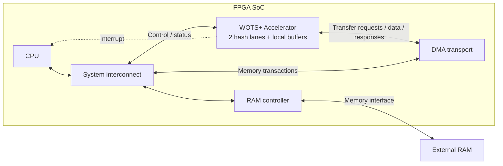

# Multi-Lane WOTS+ Accelerator with DMA and External RAM

**Target algorithm:** FIPS 205 SLH-DSA-SHAKE-128f

**Document version:** 0.1, 27 September 2026

**Document status:** Draft design contract for review; not an implementation report

**Implementation status:** WOTS RTL, board integration, and measured PPA are not established by this document

**Planning authority:** [Official project plan](KE_HOACH_CHINH_THUC_SOC_FIPS205.md), dated 26 September 2026

**Structure adapted from:** [Specimen_SPEC.md](../../Post_Quantum_Cryptography/docs/Spec%26Architecture/Specimen_SPEC.md)

`shall` and `shall not` identify requirements. `should` identifies a recommendation.
`BASELINE` identifies a concrete choice proposed by this specification, not a
decision already approved by the team. `TBD` identifies information still needed
from the board or hash-IP owner. `UNMEASURED` identifies a performance estimate
without implementation evidence. Requirement identifiers are stable review and
verification references.

This document defines the hardware/software contract and acceptance criteria.
The official plan remains the source of schedule and project milestones; this
file does not introduce a competing schedule. ASIC signoff, ML-KEM arithmetic,
and unrelated template sections have been omitted.

**Reading order:** Sections 1–3 explain the scope and architecture; Sections 4–6
define the algorithm and RTL contracts; Section 7 defines the software/DMA ABI;
Sections 8–12 define recovery, measurement, and acceptance. Appendix A records
the research behind the design choices.

## 1. Purpose and Scope

The accelerator shall execute complete WOTS+ operations, including chain
scheduling and public-key compression, while DMA transfers operation-level
inputs and outputs between the IP and external RAM.

| Hardware operation | FIPS 205 definition | Inputs | Output |
|---|---|---|---|
| `WOTS_PKGEN` | Algorithm 6, `wots_pkGen` | `SK.seed`, `PK.seed`, WOTS address | Compressed WOTS+ public key, 16 bytes |
| `WOTS_SIGN` | Algorithm 7, `wots_sign` | Above inputs and a 16-byte WOTS message | WOTS+ signature, 560 bytes |
| `WOTS_PK_FROM_SIG` | Algorithm 8, `wots_pkFromSig` | `PK.seed`, WOTS address, 16-byte message, 560-byte signature | Candidate compressed WOTS+ public key, 16 bytes |

The WOTS message is an internal FORS/XMSS public-key value, not the application's
arbitrary-length message. `WOTS_PK_FROM_SIG` does not return a cryptographic
accept/reject decision. Full SLH-DSA verification must also reconstruct the
remaining tree path and compare the resulting root with the public key.

### 1.1 Required implementation and ownership

| Component | Responsibility | Source/ownership |
|---|---|---|
| WOTS engine | Base-16 conversion, checksum, ADRS, lane jobs, scheduling, ordering, compression control | Student-designed RTL |
| Hash backend adapter | FIPS input formatting and adaptation to the group's SHAKE interface | Student-designed integration RTL |
| SHAKE256/Keccak backend | Actual SHAKE/permutation computation | Reused group IP, with author, revision, and license recorded |
| Descriptor frontend and dataflow | Descriptor interpretation, buffering, DMA requests, completion ordering | Student-designed integration logic |
| Bus DMA transport | Burst reads/writes and responses | Existing permitted DMA IP or a separately reviewed wrapper; record which implementation is used |
| CPU, interconnect, RAM controller | Driver execution, bus transport, physical RAM access | Reused platform components |
| Driver and tests | Buffer ownership, command submission, oracle comparison, measurement | Project integration work |

At least two independent instances of the group's hash backend shall be active
in the assessed two-lane configuration. A software/behavioral SHAKE model is a
simulation aid and shall not substitute for FPGA hash hardware.

Here, a WOTS lane means one independent chain execution unit and its hash
backend. It is distinct from a 64-bit lane inside the Keccak state.

The previous platform preference is Artix-7. The updated plan leaves the exact
board, bus, and accepted external-RAM technology open. This spec therefore keeps
the core bus-neutral, with an Artix-7 integration profile proposed in Section 7.
An Artix-7 FPGA alone does not supply a hard Arm processing system.

### 1.2 Normative references and precedence

1. [NIST FIPS 205 final, August 2024](https://doi.org/10.6028/NIST.FIPS.205):
   Sections 4.2–4.4, Algorithms 4–8, Table 2, and Section 11.1.
   A [local copy](../../Post_Quantum_Cryptography/docs/standards/NIST.FIPS.205.pdf)
   is available.
2. [NIST FIPS 202](https://doi.org/10.6028/NIST.FIPS.202): SHAKE256 and
   Keccak-f[1600].
3. The selected SystemVerilog language/tool revision and the selected bus/DMA
   protocol shall be recorded in the implementation manifest.

FIPS 205 final controls algorithmic correctness. This specification controls the
proposed integration ABI. Papers and repository code are informative references;
neither overrides FIPS 205. Before version 1.0, the team shall record the exact
standard documents, reviewed errata, backend revision, and platform configuration.

### 1.3 Non-goals for this release

- Full RTL KeyGen, Sign, Verify, FORS, XMSS, and hypertree traversal.
- SHA2 parameter sets, other security categories, and SPHINCS+ robust variants.
- A new SHAKE core, RNG/TRNG, cache-coherent DMA fabric, or general-purpose hash API.
- An application-facing standalone WOTS signing service. The caller owns the
  WOTS address/key-use discipline required by the enclosing SLH-DSA algorithm.
- NIST certification, masking, side-channel resistance, or fault resistance claims.

Full SLH-DSA may later use this engine through firmware calls. No Merkle stack
or TreeHash controller is required inside this WOTS IP.

## 2. Configuration and Representation

### 2.1 Fixed algorithm parameters

| Symbol | Value | Meaning in this design |
|---|---:|---|
| `n` | 16 bytes | Seed, chain value, WOTS message, compressed WOTS public key |
| `lg_w`, `w` | 4, 16 | Base-16 digits and maximum 15 F evaluations per chain |
| `len1`, `len2`, `len` | 32, 3, 35 | Message digits, checksum digits, total chains |
| `h`, `d`, `h_prime` | 66, 22, 3 | Enclosing hypertree parameters |
| `k`, `a`, `m` | 33, 6, 34 bytes | Enclosing FORS/digest parameters; not WOTS datapath dimensions |
| WOTS signature/vector | 560 bytes | 35 elements in ascending chain-index order |
| Full SLH-DSA PK/SK/signature | 32 / 64 / 17,088 bytes | Context only; not the WOTS DMA output sizes |
| SHAKE rate/capacity/state | 1,088 / 512 / 1,600 bits | Rate is 136 bytes |
| Keccak rounds | 24 | All rounds required for each permutation |

The `128` in SHAKE-128f does not mean SHAKE128: the underlying XOF is SHAKE256.
Parameters and encodings shall have one versioned source, proposed as
`wots_parameters_pkg.sv` plus a generated driver header. These are intended files,
not existing implementation dependencies.

### 2.2 Baseline microarchitecture parameters

| Parameter | Baseline | Meaning |
|---|---|---|
| `NUM_LANES` | 2 | Compile-time; also build 1 for comparison; 4 is optional after 2 passes |
| `JOB_SLOTS` | 2 | Ping-pong operation buffers |
| Active WOTS compute jobs | 1 | Lanes cooperate on the same operation; other slot can load or drain |
| Hash engines | `NUM_LANES` | One physical engine per lane |
| Separate compression engine | 0 | `T_len` temporarily owns lane 0's backend |
| Local hash/DMA stream width | 64 bits | Width conversion stays in wrappers |
| Chain value width | 128 bits | One complete chain value |
| DMA address fields | 64 bits in ABI | Proposed first platform supports 32 significant bits |
| CSR data width | 32 bits | Register offsets independent of external bus protocol |
| DMA burst limit | 128 bytes | Wrapper may split further to satisfy its bus |
| Descriptor execution | Finite contiguous batch | No descriptor ring ownership protocol in version 0.1 |

### 2.3 Byte order

**WOTS-REP-001.** Seed, message, signature, and output arrays shall retain their
FIPS byte order. A 64-bit stream beat carries the earliest byte in bits `[7:0]`,
the next in `[15:8]`, and so on. A packed 128-bit chain value uses the same
convention. This is a transport convention, not a reversal of the byte string.

**WOTS-REP-002.** Descriptor/CSR/completion integers are little-endian. ADRS
integer fields are big-endian byte strings. Adapters shall not apply a blanket
word swap to both representations.

**WOTS-REP-003.** SHAKE byte-to-state mapping shall follow FIPS 202. Neither
the 128-bit chain packing nor the big-endian ADRS fields changes Keccak's
byte/bit mapping.

## 3. Top-Level Architecture



This system-level view shows six integration blocks. The CPU runs the driver
and reaches the accelerator's control/status registers through the interconnect.
The DMA transport is a memory master: it reaches external RAM through the same
interconnect and RAM controller. External RAM is physically outside the FPGA;
the WOTS job buffers remain on chip.

The CPU is shown inside the FPGA for the proposed soft-CPU profile. An external
host can replace it through a bridge without changing the WOTS core contract.
This is a memory-mapped accelerator architecture; a CPU instruction-extension
interface such as CV-X-IF is not required by this specification.

The accelerator is grouped into four implementation subsystems. Small helpers
stay inside these groups instead of appearing as separate top-level IP blocks.

| Subsystem inside WOTS+ Accelerator | Included functions |
|---|---|
| Host and DMA frontend | CSR, interrupt, performance counters, descriptor parsing, DMA request/response handling, input/output packing |
| WOTS control | Operation sequencing, base-16/checksum, ADRS formatting, chain-job generation/scheduling, result tracking, T_len sequencing |
| Hash-lane array | Two lane controllers, chain-value registers, backend adapters, two SHAKE256 instances; lane 0 ownership mux for T_len |
| Local job memory | Two job slots containing contexts, input signatures, ordered results and output buffers; memory-port arbitration |

These are RTL hierarchy boundaries, not a requirement for exactly four FSMs.
The control-ownership table below retains the responsibilities of the internal
logic. Reordering is an indexed write into local result memory; T_len streams
that memory through lane 0's hash backend. Neither needs a separate system-level
IP or a third hash engine.

### 3.1 Control ownership

| Owner | State it exclusively updates | Responsibilities |
|---|---|---|
| Batch/descriptor frontend | Batch index, slot state, DMA bookkeeping | Fetch, validate, stage, retire jobs in submission order |
| WOTS operation controller | Active slot, mode, operation phase | Start digit conversion, enable scheduling, enforce chain/compression barrier |
| Scheduler | Unassigned-chain set and lane assignment | Dispatch each chain exactly once |
| Each lane controller | Chain index, current hash step, remaining steps, current value | Execute PRF/F sequence; hold result until accepted |
| Result controller | Valid bitmap, accepted-result count, write arbitration | Store by chain index; prevent duplicate/missing results |
| Compression controller | Ordered read pointer, payload beat counter | Feed `T_len`; exclusively borrow backend 0 |
| Backend wrapper | SHAKE state and hash transaction state | Complete one hash transaction correctly |

**WOTS-ARCH-001.** Each architectural register shall have one writer. Sharing an
immutable seed/address base across lanes is permitted; sharing one mutable hash
address between lanes is prohibited.

The baseline uses hierarchical control because DMA, lanes, and writeback can
wait independently. The operation controller shall not reproduce a backend's
Keccak round FSM. A team may merge small control modules while preserving the
contracts and observable behavior in this specification.

### 3.2 Local storage and lifetime

| Object | Logical capacity | Producer → consumer | Lifetime / policy |
|---|---:|---|---|
| Descriptor snapshot | 128 bytes per slot | DMA → frontend | Until completion; immutable after validation |
| Input context | 80 bytes per slot | DMA → formatter/lanes | Until job retirement; secret seed present in signing modes |
| Input signature | 560 bytes per slot | DMA → lane dispatch | PK_FROM_SIG only; preserved until last required load |
| Digit vector | 35 × 4 bits per slot | Checksum → job generator | SIGN/PK_FROM_SIG; 18-byte packed allocation |
| Result vector | 560 bytes per slot | Lanes → compression/output | Indexed by chain, not completion order |
| Result-valid bitmap | 35 bits per slot | Result controller | Cleared before reuse |
| Compressed output | 16 bytes per slot | Compression → DMA | Until write acknowledgement |
| Chain state | 16 bytes per lane plus counters/tags | Lane ↔ hash adapter | Until result acceptance, then cleared before reassignment |
| Keccak state | 200 bytes per backend | Backend | Never exported through normal CSRs |

Two slots account for 2,724 bytes for descriptor, context, signature, digits,
result vector, and compressed output alone. This excludes tags, bitmaps, FIFOs,
lane state, and backend state. It is a logical byte count, not a BRAM utilization
claim; physical banking/port width can increase allocation substantially.

**WOTS-MEM-001.** Active chain values and repeated hash inputs shall stay on chip.
No per-F DMA transaction is permitted in the baseline.

**WOTS-MEM-002.** A slot shall progress through
`FREE → FETCH → READY → COMPUTE → WRITEBACK → SCRUB → FREE`.
Only its owner may write its current storage. A slot shall not be reassigned
while an outstanding DMA request, lane result, or hash response references it.

### 3.3 Result memory ports and lane concurrency

The baseline result bank has one logical 128-bit write port and one read port.
A round-robin arbiter accepts at most one lane completion each cycle. Each lane
holds one pending result; a blocked result shall remain stable. This avoids
assuming a BRAM has `NUM_LANES` write ports. Two simultaneous completions may
take two cycles to store; that does not prevent the lanes hashing concurrently.

The read side serializes chain values into 64-bit beats. Reading the result bank
for `T_len` or signature writeback begins only after all 35 writes are accepted.
Slot banking separates older-job output reads from current-job result writes.
Input-signature dispatch may similarly serialize a read; record this cost in
the cycle model rather than assuming unlimited BRAM bandwidth.

### 3.4 System pipeline

**WOTS-PIPE-001.** With two or more jobs and responsive RAM, descriptor/input DMA
for job `j+1` shall be able to overlap chain computation for job `j`. Output DMA
for job `j` shall be able to overlap computation for job `j+1` once its input is
ready. The design need not have three full jobs resident at once.

```text
Slot A / job 0:  fetch inputs | chain compute | T_len or sign pack | DMA out | scrub
Slot B / job 1:               fetch inputs   | ready              | compute ...
Slot A / job 2:                                                            fetch ...
```

`T_len` starts after the current job's chain barrier and uses lane 0. The next
job's chain computation waits until compression releases that backend. Overlap
between compression and next-job chains is an optional future optimization,
not required to demonstrate the baseline DMA/compute pipeline.

Before switching the compute job, clear its lane/backend secret state and cached
seed copies. Scrubbing the previous job's slot during the next job's computation
shall affect only that previous slot, not the backends now owned by the new job.
This separation is necessary to preserve both zeroization and pipeline overlap.

## 4. Functional Requirements

### 4.1 Mode behavior

For chain index `i` in `0..34`, let `digit[i]` be the message/checksum digit.

| Mode | Initial value | PRF count per chain | First F address | F count | Final operation |
|---|---|---:|---:|---:|---|
| PKGEN | PRF result | 1 | 0 | 15 | `T_len` over 35 endpoints |
| SIGN | PRF result | 1 | 0 | `digit[i]` | Return 35 selected values |
| PK_FROM_SIG | Input `signature[i]` | 0 | `digit[i]` | `15 - digit[i]` | `T_len` over 35 endpoints |

**WOTS-FUNC-001.** All three modes shall match FIPS 205 Algorithms 6–8 byte for
byte. SIGN shall not execute public-key compression. PK_FROM_SIG shall not
require or consume `SK.seed` as a hash input.

**WOTS-FUNC-002.** Every successful operation shall return exactly 560 bytes for
SIGN or 16 bytes for PKGEN/PK_FROM_SIG. The 560-byte endpoint vector of PKGEN
shall remain internal in the normal ABI.

**WOTS-FUNC-003.** Zero-step chains shall be supported. SIGN still executes PRF
when its digit is zero. PK_FROM_SIG with digit 15 returns its input chain value
without PRF or F. No F call uses hash address 15 in these three modes.

### 4.2 Base-16 and checksum

For message bytes `message[0..15]`:

```text
digit[2*j]     = message[j] >> 4
digit[2*j + 1] = message[j] & 0x0f          for j = 0..15
checksum      = sum(15 - digit[i])        for i = 0..31
digit[32]     = (checksum >> 8) & 0x0f
digit[33]     = (checksum >> 4) & 0x0f
digit[34]     = checksum & 0x0f
```

This is equivalent to FIPS 205's four-bit left shift, two-byte big-endian
serialization, and extraction of the first three nibbles. The unshifted checksum
is in `0..480` and needs 9 bits. If the shifted form is stored, allocate at least
13 bits or use a 16-bit register.

| Message | First 32 digits | Checksum | Last 3 digits | Total F calls, SIGN / PK_FROM_SIG |
|---|---|---:|---|---:|
| 16 × `00` | All 0 | `0x1e0` | `1, 14, 0` | 15 / 510 |
| 16 × `ff` | All 15 | `0x000` | `0, 0, 0` | 480 / 45 |
| 16 × `a5` | `10, 5` repeated | `0x0f0` | `0, 15, 0` | 255 / 270 |

**WOTS-FUNC-004.** The checksum shall use the 32 message digits only. The same
digit vector shall drive SIGN and PK_FROM_SIG for identical message bytes.

### 4.3 ADRS generation

All offsets below are byte offsets in the 32-byte address, inclusive.

| Bytes | Field | Encoding |
|---|---|---|
| 0–3 | Layer address | 32-bit big-endian |
| 4–15 | Tree address | 96-bit big-endian |
| 16–19 | Address type | 32-bit big-endian |
| 20–23 | WOTS key-pair address | 32-bit big-endian |
| 24–27 | Chain address | 32-bit big-endian, or zero for WOTS_PK |
| 28–31 | Hash address | 32-bit big-endian, or zero where unused |

| Function | Type | Chain field | Hash field |
|---|---:|---|---|
| PRF | `WOTS_PRF = 5` | `i` | 0 |
| F | `WOTS_HASH = 0` | `i` | Current step, 0–14 |
| `T_len` | `WOTS_PK = 1` | 0 | 0 |

**WOTS-ADRS-001.** The frontend accepts a canonical WOTS base address: type 0,
chain 0, hash 0; the layer, tree, and key-pair fields identify the operation.
It shall validate layer `0..21`, key-pair `0..7`, and
`tree < 2^(63 - 3*layer)` for this fixed parameter set. At layer 21 the tree is 0.
The full 96-bit representation shall be retained even though valid tree indices
fit in fewer bits.

**WOTS-ADRS-002.** Forming each type shall have the effect of
`setTypeAndClear(type)` followed by restoring the key-pair field and any required
chain/hash fields. Retaining stale final-12-byte fields is prohibited.

**WOTS-ADRS-003.** Each lane shall derive a private address from the immutable
base and its local chain/step counters. A combinational formatter is sufficient;
an independent ADRS FSM is not required.

The WOTS key-pair index is supplied by firmware. It is not a leaf counter that
this IP advances through an XMSS tree. SHAKE uses all 32 ADRS bytes; the compressed
22-byte SHA2 address format shall not be used.

### 4.4 Hash messages and compression

The following are byte-string concatenations; `SHAKE256_16` means 16 output bytes:

```text
PRF    = SHAKE256_16(PK.seed || ADRS_WOTS_PRF  || SK.seed)
F(X)   = SHAKE256_16(PK.seed || ADRS_WOTS_HASH || X)
T_len  = SHAKE256_16(PK.seed || ADRS_WOTS_PK   || result[0] || ... || result[34])
```

| Operation | Message bytes before SHAKE padding | Absorb permutations | Output |
|---|---:|---:|---:|
| PRF | 64 | 1 | 16 bytes |
| F | 64 | 1 | 16 bytes |
| `T_len` | 608 = 16 + 32 + 560 | 5 | 16 bytes |

**WOTS-HASH-001.** Compression shall be one SHAKE256 invocation over the entire
608-byte message. Hashing chunks independently or restarting the state at each
rate block is incorrect. The first 16 output bytes need no additional squeeze
permutation after the final absorb permutation.

For byte-aligned SHAKE, the final block includes delimited suffix `0x1f` and
the final `0x80` padding bit. PRF/F place the suffix at rate-byte 64. `T_len`
contains four full 136-byte blocks and 64 message bytes in its final block, so
its suffix also occurs at rate-byte 64. The last rate-byte is 135. Padding
ownership is specified in Section 6; it shall occur exactly once.

## 5. Internal Command, Scheduling, and Completion Contracts

### 5.1 Common handshake

**WOTS-HS-001.** Every `valid/ready` transfer occurs only on a rising clock edge
where both signals are asserted. A producer shall hold `valid` and all associated
payload fields stable while stalled. A consumer shall accept each transfer once.
These rules apply to lane commands, lane results, hash commands/payload/results,
and DMA wrapper channels.

The baseline has at most one outstanding chain job per lane and one outstanding
hash invocation per backend. Throughput shall not depend on either interface
accepting and responding in the same cycle.

### 5.2 Chain command

| Field | Width | Meaning |
|---|---:|---|
| `slot_id` | 1 | Physical job slot 0 or 1 |
| `job_sequence` | 32 | Batch descriptor index, stable until drain |
| `chain_index` | 6 | 0–34 |
| `generate_secret` | 1 | Execute PRF before any F calls |
| `start_step` | 4 | 0–15 |
| `step_count` | 4 | 0–15; `start_step + step_count <= 15` |
| `initial_value` | 128 | Signature element for PK_FROM_SIG; zero otherwise |

The job context supplies immutable `PK.seed`, base ADRS, and, where needed,
`SK.seed`. A lane shall latch the command/context or retain a protected reference
to a slot that cannot be modified. `start_step + step_count` shall be checked in
at least 5 bits to avoid overflow.

Lane results carry `{slot_id, job_sequence, chain_index, value[127:0], error}`.
No result is considered stored until its result handshake is accepted.

**WOTS-CHAIN-001.** A lane increments its hash-step counter only after successful
completion of the corresponding F invocation, not when a request is presented
or stalled. It shall hold the current value until the next hash has captured it.

### 5.3 Scheduling policies

**WOTS-SCHED-001.** The release shall support the following policies, selected
at batch start and unchanged while BUSY:

- `STATIC = 0`: chain `i` belongs to lane `i mod NUM_LANES`; each lane processes
  its indices in ascending order.
- `DYNAMIC = 1`: dispatch the lowest unassigned chain index to an available
  lane. When several lanes are available, use ascending lane index as tie-break.

The physical dispatch implementation may accept one chain per cycle. It shall
not wait for all lanes to become idle before assigning more work. Each assigned
chain runs to completion on its lane; step-level migration/preemption is absent.

**WOTS-SCHED-002.** Each of the 35 chains shall be assigned exactly once. Lane
count and scheduling policy shall not alter outputs. Dynamic scheduling is a
measured optimization, not a promised improvement for every message.

### 5.4 Reordering and `T_len` ownership

**WOTS-ORDER-001.** Store accepted results at logical index `chain_index` and
set that entry's valid bit. Duplicate indices, wrong sequence/slot, or indices
above 34 are internal errors. The complete vector is
`result[0] || result[1] || ... || result[34]` regardless of completion order.

**WOTS-ORDER-002.** The compression controller may request backend 0 only when
all 35 results are stored and every lane/hash transaction for that job has
drained. The ownership mux shall then exclude lane-chain requests until the
compression result is accepted. Other backends are idle during baseline
compression. Ownership cannot switch partway through absorb or squeeze.

For SIGN, the operation goes directly from the chain barrier to ordered output.
No global hash arbiter is needed for ordinary chain execution: each lane owns
its backend. Only backend 0 has a chain/compression ownership mux.

### 5.5 Suggested lane FSM

```text
IDLE → LOAD_COMMAND → [PRF_REQUEST → PRF_WAIT]
     → CHECK_STEPS → F_REQUEST → F_WAIT → CHECK_STEPS
     → RESULT_HOLD → CLEAR_LOCAL_STATE → IDLE
```

The bracketed PRF path is conditional. `CHECK_STEPS` bypasses F for a zero-step
chain. State names are informative; handshakes and algorithm behavior are
normative. Do not encode each chain index or each hash iteration as a separate
FSM state; use counters.

## 6. Hash-Backend Adaptation

### 6.1 WOTS-to-adapter interface

Each lane exposes a separate adapter port. The same port on lane 0 is routed to
compression while compression owns the backend.

| Channel | Fields | Contract |
|---|---|---|
| Command | `req_valid`, `req_ready`, `operation[1:0]`, `context_tag[39:0]`, `public_seed[127:0]`, `address[255:0]`, `payload_bytes[9:0]` | Operations 0=PRF, 1=F, 2=T_LEN; 3 illegal |
| Payload | `data_valid`, `data_ready`, `data[63:0]`, `keep[7:0]`, `last` | Contains only SK.seed, X, or the endpoint vector |
| Result | `rsp_valid`, `rsp_ready`, `context_tag[39:0]`, `value[127:0]`, `error` | One response per accepted hash command |

`context_tag = {job_sequence[31:0], slot_id, item_index[6:0]}`. Chain indices use
0–34; item index 35 identifies compression. A fresh batch cannot start until
all old responses have drained, so reusing a sequence number after quiescence
cannot alias a live response.

**WOTS-HASH-002.** `payload_bytes` shall be 16 for PRF/F or 560 for T_LEN.
It excludes the 48-byte prefix, which the adapter constructs. Each payload beat
has `keep = 0xff`; `last` is asserted on beat 2 or beat 70 respectively. Incorrect
length, early/late `last`, unknown operation, or wrong response tag is an error.

The adapter emits the prefix `PK.seed || ADRS` and the payload to the backend.
Thus the backend sees 8 full 64-bit beats for PRF/F and 76 for T_LEN before
padding. A backend with a different bus width is adapted locally.

### 6.2 Padding and state ownership

**WOTS-HASH-003.** The WOTS/hash-adapter boundary always carries unpadded data.
The preferred backend profile accepts unpadded SHAKE messages and owns padding,
absorb, and squeeze. If the group's IP exposes only Keccak permutation, its
wrapper shall implement these functions. A static integration setting shall
select exactly one padding owner; runtime ambiguity is prohibited.

**WOTS-HASH-004.** Every PRF, every individual F invocation, and every T_LEN
invocation begins a fresh SHAKE state. T_LEN preserves state between its rate
blocks. Reusing the previous F sponge state as the next F input is incorrect.

**WOTS-HASH-005.** The wrapper shall preserve result data under backpressure
even if the underlying IP provides only a one-cycle `done` pulse. Backend reset
and scrub shall cover any secret-bearing state or staging registers.

### 6.3 Required backend handover information

Before RTL integration is frozen, the hash-IP owner shall provide:

| Item | Required evidence |
|---|---|
| Identity | Repository/path, commit or archive hash, author, reuse permission |
| Pins and timing | Port widths, byte mapping, handshake, reset behavior |
| Functionality | SHAKE256 support or raw permutation interface; all 24 rounds |
| Padding | Owner and exact input convention |
| Multi-block support | 608-byte message test, with state retained across blocks |
| State lifetime | Fresh-operation initialization and zeroization mechanism |
| Performance | Permutation latency, hash latency, initiation interval; measured or explicitly estimated |
| FPGA cost | Synthesis evidence for one and two instances on the selected device |

No assumption that the group's core has SLotH's 24-cycle permutation latency
is permitted. A reference hash model may implement this interface for testbench
development while real-IP handover is pending.

## 7. Host, DMA, and External-Memory Interface

### 7.1 Proposed platform profile

The core and DMA-request frontend shall remain independent of AXI or Avalon.
For an Artix-7 board, the proposed wrapper uses a soft CPU or an external host,
32-bit AXI4-Lite CSRs, and an AXI memory DMA path to a board-supported external
DRAM controller. This is a proposal, not evidence that a particular board has
DRAM or that a DMA IP has been selected.

The final implementation shall identify who interprets WOTS descriptors. In
this baseline it is `dma_descriptor_frontend`, which requests byte ranges from
the transport. A vendor DMA scatter/gather descriptor is a separate format;
it shall not be confused with the WOTS descriptor below. An AXI-Stream-only
DMA needs the control wrapper that programs its transfers.

The release shall use actual off-chip RAM. On-chip BRAM used for simulation or
bring-up does not satisfy the external-RAM demonstration requirement.

### 7.2 Submission model

**WOTS-HOST-001.** The host submits one finite batch of 1–65,535 descriptors.
Descriptors are contiguous 128-byte entries; completion records are contiguous
32-byte entries. Only one batch is active. Descriptors execute and retire in
index order; prefetch does not permit out-of-order completion.

The CPU shall prepare all descriptors and input buffers before START and shall
not modify them until the batch reaches a quiescent terminal state. All descriptor
and completion integers use the little-endian ABI in Section 2.3.

### 7.3 Descriptor layout, ABI version 1

| Offset | Size | Field | Meaning |
|---:|---:|---|---|
| `0x00` | 2 | `abi_version` | 1 |
| `0x02` | 1 | `operation` | 0=PKGEN, 1=SIGN, 2=PK_FROM_SIG |
| `0x03` | 1 | `parameter_set` | Project-local encoding 0=SLH-DSA-SHAKE-128f |
| `0x04` | 4 | `flags` | 0; all bits reserved |
| `0x08` | 8 | `job_cookie` | Opaque identifier copied to completion |
| `0x10` | 8 | `context_address` | Address of 80-byte context |
| `0x18` | 8 | `signature_address` | PK_FROM_SIG input; zero for other modes |
| `0x20` | 8 | `output_address` | Destination, separate from inputs |
| `0x28` | 4 | `context_bytes` | Exactly 80 |
| `0x2c` | 4 | `signature_bytes` | Exactly 560 for PK_FROM_SIG; zero otherwise |
| `0x30` | 4 | `output_capacity` | At least 560 for SIGN, at least 16 otherwise |
| `0x34` | 4 | `reserved_0` | Zero |
| `0x38` | 72 | `reserved_1` | All zero |

Mode belongs to the descriptor. There is no conflicting CSR mode or redundant
SRC/DST register path in the baseline.

### 7.4 Context layout

| Offset | Size | Field | Rule |
|---:|---:|---|---|
| `0x00` | 16 | `public_seed` | Required for every mode |
| `0x10` | 16 | `secret_seed` | Required for PKGEN/SIGN; shall be zero in PK_FROM_SIG |
| `0x20` | 32 | `base_address` | Canonical ADRS from Section 4.3 |
| `0x40` | 16 | `message` | Required for SIGN/PK_FROM_SIG; shall be zero in PKGEN |

The frontend reads exactly 80 bytes and validates unused zero fields. Secret
seed data is never taken from the context by PK_FROM_SIG hash logic.

**WOTS-DMA-001.** Descriptor-base alignment is 128 bytes, completion-base
alignment is 32 bytes, and context/signature/output alignment is at least 16
bytes. Software should use cache-line alignment where stricter. All pointer
arithmetic shall be checked for wrap and unsupported high address bits. The
32-bit platform profile rejects nonzero upper pointer bits.

**WOTS-DMA-002.** Validate descriptor fields and output capacity before issuing
its payload reads or output writes. Validate context ADRS before starting any
chain. Read exactly the declared supported input sizes; write exactly the mode's
output size, never the entire output capacity or rounded-up padding bytes.

Software shall allocate accessible, non-overlapping output/completion regions
and shall keep them disjoint from every batch descriptor and input region.
Read-only input sharing between descriptors is allowed. The baseline hardware
does not perform an all-pairs overlap analysis across the batch; the trusted
driver owns that precondition. An address being aligned is not proof that it
is mapped or accessible; bus faults still require handling.

### 7.5 DMA transport contract

The wrapper exposes separate read and write request/data/response paths.

| Channel | Minimum information |
|---|---|
| Read request | Valid/ready, byte address, byte count, slot/request tag |
| Read data | Valid/ready, 64-bit data, byte-valid mask, last, tag, error |
| Write request | Valid/ready, byte address, byte count, slot/request tag |
| Write data | Valid/ready, 64-bit data, byte strobes, last |
| Write response | Valid/ready, tag, error; means the transfer has completed, not merely entered a FIFO |

**WOTS-DMA-003.** The baseline permits one outstanding read burst and one
outstanding write burst, with independent progress. Split transfers at the
128-byte burst limit, the physical bus limit, and any required 4-KiB boundary.
Neither reads nor writes may cross beyond the requested buffer. Byte strobes
shall support the four-byte completion-status commit.

**WOTS-DMA-004.** Fetch and writeback shall receive bounded service under a
responsive memory system. Writeback/completion requests take priority over new
prefetch requests if they share an internal resource. A full slot shall throttle
prefetch, not overwrite live data. One stalled stream shall not create a circular
dependency between lane completion and output drainage.

### 7.6 Completion record and ordering

| Offset | Size | Field |
|---:|---:|---|
| `0x00` | 8 | `job_cookie` |
| `0x08` | 4 | `descriptor_index` |
| `0x0c` | 4 | `status`: 0=NOT_COMMITTED, 1=SUCCESS, 2=FAILED |
| `0x10` | 4 | `output_bytes`: 16/560 on success, 0 on failure |
| `0x14` | 4 | `error_code`: 0 on success |
| `0x18` | 8 | `compute_cycles` |

**WOTS-COMP-001.** Before START, software shall set every completion status to
NOT_COMMITTED and make these stores visible to DMA. For each success, hardware
shall execute this ordering:

1. Finish the operation and obtain the exact output bytes.
2. DMA-write the output and wait for successful write responses.
3. Write the 32-byte completion body with status NOT_COMMITTED and wait for its
   response.
4. Write the four-byte SUCCESS status last and wait for its response.
5. Advance `COMPLETED_COUNT`. Retire/scrub the slot before reusing it.

The wrapper shall preserve these ordering guarantees across the actual memory
system. Software uses completion plus cache maintenance/acquire barriers before
reading output. A hash `done`, a stream `last`, or acceptance into a DMA FIFO
shall not by itself set batch DONE.

On a job error, previously retired jobs remain valid. Stop at the failing
descriptor, drain all issued transactions, and, if the completion path works,
commit a FAILED record with zero output length. Later descriptors shall not
commit output or completion. A prefetched error is retained until older jobs
retire; prefetch shall not publish it ahead of those jobs.

If descriptor fetch fails, its cookie is unknown: use zero in an attempted
FAILED completion and report the descriptor index in CSR. If completion itself
cannot be written, CSR error reporting is authoritative; do not recursively
attempt another completion record. A failed output write can leave partial
bytes in RAM; software shall discard them, even though rollback is impossible.

### 7.7 CSR register map, proposed version 1

Offsets are relative to the wrapper-assigned base. All accesses are aligned
32-bit words; reserved offsets and malformed writes return the wrapper's error
response and have no side effects. Read-only writes fail. R/W configuration
writes while BUSY fail and leave the running batch unchanged.

| Offset | Register | Access | Reset / fields |
|---:|---|---|---|
| `0x000` | `IDENTIFICATION` | RO | `0x574f5453`, identifying WOTS |
| `0x004` | `ABI_VERSION` | RO | `0x00000001` |
| `0x008` | `CAPABILITIES` | RO | `[7:0]` compiled lanes; `[15:8]` slots=2; `[23:16]` DMA address bits; `[26:24]` supported modes=`111`; `[27]` dynamic-policy support=1 |
| `0x010` | `CONTROL` | W1P | Bit 0 START; 1 ABORT; 2 SOFT_RESET; reads as zero |
| `0x014` | `STATUS` | RO | Bit 0 BUSY; 1 DONE; 2 ERROR; 3 ABORTED; 4 SCRUB_BUSY; 5 RECOVERY_REQUIRED |
| `0x018` | `ERROR_CODE` | RO | First fatal error for the last/active batch; initially 0 |
| `0x01c` | `ERROR_INDEX` | RO | Failing descriptor index; `0xffffffff` when not applicable |
| `0x020` | `DESCRIPTOR_BASE_LO` | RW | 0 |
| `0x024` | `DESCRIPTOR_BASE_HI` | RW | 0 |
| `0x028` | `COMPLETION_BASE_LO` | RW | 0 |
| `0x02c` | `COMPLETION_BASE_HI` | RW | 0 |
| `0x030` | `JOB_COUNT` | RW | 0; legal START requires 1–65,535 |
| `0x034` | `SCHEDULER_POLICY` | RW | 1=DYNAMIC; 0=STATIC |
| `0x038` | `WATCHDOG_CYCLES` | RW | 0 disables; host shall configure a platform-appropriate bound |
| `0x03c` | `COMPLETED_COUNT` | RO | Number of successfully committed jobs; 0 at START |
| `0x040` | `IRQ_ENABLE` | RW | Bits 0 completion, 1 error, 2 aborted; initially 0 |
| `0x044` | `IRQ_STATUS` | RW1C | Sticky bits corresponding to IRQ_ENABLE; initially 0 |
| `0x048` | `PERF_SNAPSHOT` | W1P | Bit 0 snapshots live counters into the read bank |
| `0x04c` | `CURRENT_INDEX` | RO | Active/oldest-unretired index; `0xffffffff` when idle |
| `0x050` | `COMMAND_REJECT` | RW1C | Bit 0 rejected START; bit 1 rejected configuration/control access |
| `0x080..0x0ff` | Global performance bank | RO | 64-bit counters, low word then high word; Section 9 |
| `0x100 + 0x20*l` | Per-lane performance bank | RO | 32-byte stride for lane `l`; Section 9 |

All unspecified bits read zero and shall be written zero. Partial-byte CSR
writes are rejected. CONTROL accepts one pulse bit per write; simultaneous
commands are rejected. ABORT while idle is a harmless no-op. SOFT_RESET is
accepted only when idle and not RECOVERY_REQUIRED; it clears batch state and
scrubs local storage, keeping immutable identification/capability values.

**WOTS-HOST-002.** START snapshots base addresses, count, policy, and watchdog.
It is accepted only when idle, scrub is complete, configuration is valid, no IRQ
bits remain pending, and recovery is not required. It clears prior terminal
status, errors, completed count, and performance counters. Rejected START sets
COMMAND_REJECT without aborting or modifying an existing batch.

**WOTS-IRQ-001.** `irq = OR(IRQ_STATUS & IRQ_ENABLE)` shall be level-sensitive.
Completion is raised once for a fully successful batch after all outputs,
completion records, DMA responses, and scrubbing finish. Error or ABORT raises
its corresponding sticky event; it shall not also raise successful completion.
Concurrent event-set and W1C shall be set-dominant. Firmware may poll instead.

At successful batch termination, STATUS.DONE is set and BUSY clears. Fatal
non-abort termination sets ERROR; clean host-abort termination sets ABORTED.
Terminal bits remain latched until an accepted START or SOFT_RESET. SCRUB_BUSY
indicates any active cleanup. An ordinary per-slot scrub does not end the batch.

### 7.8 Driver sequence and cache ownership

1. Allocate DMA-reachable descriptor, context, signature, output, and completion
   buffers. Use DMA/bus addresses, not arbitrary CPU virtual addresses.
2. Fill immutable descriptors/inputs and clear completion statuses. Clean caches
   or use uncached/coherent allocations according to the selected platform.
   Prepare output cache lines so dirty CPU data cannot overwrite DMA results.
3. Program batch CSRs while idle, clear old IRQ bits, then issue a release
   barrier and START.
4. Wait by interrupt or polling, with a software timeout. Do not read/write
   accelerator-owned buffers while BUSY except using a documented completion
   polling/cache-maintenance procedure.
5. On quiescent completion, invalidate relevant output/completion cache lines,
   execute the required acquire barrier, and validate status, index, and cookie.
6. Consume only successful outputs; reclaim/wipe secret input buffers according
   to application policy. Acknowledge IRQ. Resolve recovery before resubmitting.

CPU cache coherence shall not be assumed merely because both masters reach the
same RAM controller.

## 8. Clock, Reset, Error, and Recovery Requirements

**WOTS-CLK-001.** The baseline WOTS core, local buffers, and backend wrappers
shall use one clock domain. The target frequency is TBD until the backend and
device are known. RAM/controller/CPU clocks may differ only through reviewed
bus bridges or asynchronous FIFOs. Record clock relationships and timing constraints.

**WOTS-RST-001.** Reset deassertion shall be synchronized in every affected
domain. After reset, BUSY remains asserted during initialization/scrub, all
valid maps and ownership state are cleared, and no descriptor runs before a new
START. Resetting WOTS state alone does not cancel an outstanding bus write.

### 8.1 Error codes

| Code | Name | Trigger |
|---:|---|---|
| 0 | NONE | No fatal error |
| 1 | BAD_DESCRIPTOR | Version, mode, parameter encoding, flags, reserved bytes |
| 2 | BAD_LENGTH | Context/signature size or output capacity |
| 3 | BAD_ADDRESS | Alignment, address wrap, unsupported address bits |
| 4 | BAD_CONTEXT | Noncanonical ADRS, invalid address range, nonzero unused fields |
| 5 | DMA_READ_ERROR | Failed descriptor or payload read |
| 6 | DMA_WRITE_ERROR | Failed output/completion write |
| 7 | HASH_ERROR | Backend error, hash framing, or hash response mismatch |
| 8 | INTERNAL_ERROR | Duplicate chain, wrong ownership, invalid counter/state |
| 9 | TIMEOUT | No-progress watchdog expiration |
| 10 | ABORTED_BY_HOST | Accepted ABORT during a batch |

**WOTS-ERR-001.** The first fatal error shall latch its code/index. Stop issuing
new work, invalidate uncommitted results, and drain transactions already accepted
by DMA/backend interfaces. Never report SUCCESS for the failing job.

**WOTS-ERR-002.** The watchdog counts consecutive cycles with no externally
accepted transfer, backend completion, or controlled local-FSM/scrub progress
while BUSY. Counter increment alone is not progress. Expiration stops new work
and begins recovery; it does not prove that memory is quiescent.

**WOTS-ERR-003.** If an outstanding bus transaction cannot be drained, assert
RECOVERY_REQUIRED and retain BUSY. The host shall coordinate reset of the DMA
master, interconnect, and WOTS wrapper or obtain platform-specific cancellation
acknowledgement before reusing buffers. Silently dropping late responses and
starting another job is prohibited. The error IRQ may assert before quiescence
so software can initiate recovery.

An ordinary ABORT follows the same drain/scrub sequence, preserves previously
committed jobs, and marks the earliest unretired job failed when feasible. It
does not restore old bytes in a partially written output buffer. After a clean
abort, BUSY clears and ABORTED is sticky; a recovery-required abort needs the
platform recovery above.

## 9. Performance and Resource Requirements

No cycle, frequency, LUT, BRAM, or speedup number below is an achieved result.

### 9.1 Exact work counts

Let `A = sum(digit[0..34])`. Each PRF/F requires one permutation for this fixed
input size; T_LEN requires five. These are mathematical work counts, independent
of how many cycles a backend takes.

| Mode | PRF calls | F calls | T_LEN calls | Keccak permutations |
|---|---:|---:|---:|---:|
| PKGEN | 35 | 525 | 1 | 565 |
| SIGN | 35 | A | 0 | 35 + A |
| PK_FROM_SIG | 0 | 525 − A | 1 | 530 − A |

For a matching message, SIGN F-count plus PK_FROM_SIG F-count shall equal 525.
Eight PKGEN jobs provide the eight WOTS leaves needed by the top XMSS tree of
128f KeyGen. The additional seven tree-H operations and final key assembly
belong to the surrounding firmware/tree implementation, not this engine.

### 9.2 Cycle model

Define measured isolated transaction costs `C_PRF`, `C_F`, and `C_TLEN`, including
their local adapter overhead, and a separate scheduling/memory overhead term.

```text
PKGEN chain cost = C_PRF + 15*C_F
PKGEN compute estimate = ceil(35 / NUM_LANES)*(C_PRF + 15*C_F)
                       + C_TLEN + scheduling/memory overhead

SIGN chain cost[i] = C_PRF + digit[i]*C_F
PK_FROM_SIG chain cost[i] = (15 - digit[i])*C_F
```

Zero-step PK_FROM_SIG still incurs dispatch, input loading, and result-storage
cycles. Static/dynamic estimates shall assign complete-chain costs to lanes;
dividing total work by lane count ignores imbalance and interfaces.

For illustration only, if a permutation takes 24 cycles and all other overhead
is suppressed, PKGEN takes 13,560 cycles with one lane, or 7,032 cycles with two
lanes including serial compression. The ratio is about 1.93, not 2. These are
an idealized model, not a timing target for the group's IP.

### 9.3 External-memory traffic

For successful jobs without speculative fetches or bus errors:

| Mode | Descriptor + input reads | Algorithm output writes | Completion writes |
|---|---:|---:|---:|
| PKGEN | 128 + 80 = 208 bytes | 16 bytes | 32-byte body + 4-byte status commit |
| SIGN | 208 bytes | 560 bytes | 36 bytes |
| PK_FROM_SIG | 128 + 80 + 560 = 768 bytes | 16 bytes | 36 bytes |

These counts describe useful transferred bytes, not bus address phases, unused
beat lanes, CPU cache traffic, or DRAM transactions. No 560-byte PKGEN endpoint
vector is written to external RAM. Batching reduces software submissions but
does not remove per-descriptor reads in this ABI.

### 9.4 Performance counters

All counters are unsigned 64-bit, saturating at their maximum. They clear on
accepted START or SOFT_RESET. PERF_SNAPSHOT atomically copies them into a stable
read bank; terminal quiescent completion also snapshots them. Read low/high
words from the snapshot bank to avoid torn values.

| Offset | Counter | Definition |
|---:|---|---|
| `0x080` | BATCH_CYCLES | START acceptance through quiescent terminal state, including DMA and scrub |
| `0x088` | COMPUTE_CYCLES | Cycles spent in chain scheduling/execution and compression |
| `0x090` | DMA_READ_BYTES | Accepted read-data bytes, including descriptors |
| `0x098` | DMA_WRITE_BYTES | Accepted write-data strobed bytes, including completion commits |
| `0x0a0` | DMA_READ_WAIT | Cycles an outstanding read awaits data/termination; definition fixed in wrapper |
| `0x0a8` | DMA_WRITE_WAIT | Cycles write data is backpressured or write response is pending |
| `0x0b0` | HASH_COMMAND_STALL | Cycles any hash command is valid but not ready |
| `0x0b8` | RESULT_STALL | Cycles any lane holds a result that is not accepted |
| `0x0c0` | PRF_CALLS | Successfully completed PRF invocations |
| `0x0c8` | F_CALLS | Successfully completed F invocations |
| `0x0d0` | T_LEN_CALLS | Successfully completed compression invocations |
| `0x0d8` | JOBS_COMMITTED | Successful completion records committed |
| `0x0e0` | DMA_COMPUTE_OVERLAP | Cycles DMA payload transfer and WOTS compute activity coexist |
| `0x0e8` | PARALLEL_HASH_CYCLES | Cycles at least two physical backend engines are computing |
| `0x0f0` | PREFETCH_SLOT_STALL | Cycles prefetch has pending work but no free slot |
| `0x0f8` | Reserved | Reads zero |

At `0x100 + 0x20*l`, four 64-bit counters report lane `l`'s chain-busy cycles,
backend-compute cycles, completed chains, and result-backpressure cycles.
Backend-compute activity is obtained from the backend/wrapper and excludes mere
result holding; document how it is observed. Lane 0's backend cycles include
compression, while its chain-busy cycles do not.

Stall categories can overlap and shall not be summed as if they partition time.
Completion-record `compute_cycles` uses the same compute interval definition
for its own job; it excludes input prefetch, output DMA, and scrub.

### 9.5 Required experiments and implementation reports

**WOTS-PERF-001.** Compare one versus two lanes and STATIC versus DYNAMIC using
the same hash backend revision, workload, memory system, and common achieved
clock when computing cycle/speedup comparisons. Report both compute-only and
submit-to-completion measurements, with batch sizes 1, 2, 4, 8, 16, 32, 64.

**WOTS-PERF-002.** Include software WOTS, DMA batch size 1, DMA batching, and
prefetch-disabled/enabled measurements. A CPU-per-hash/MMIO baseline is optional
research instrumentation, not a required second production ABI. This narrows
the plan's optional MMIO comparison without adding an unused data path.

**WOTS-PERF-003.** The two-lane implementation shall demonstrate overlapping
hash activity with waveform and PARALLEL_HASH_CYCLES evidence. The pipeline
shall demonstrate DMA_COMPUTE_OVERLAP and a waveform showing different jobs in
different stages. Expected speedup shall be measured; no minimum 2× promise is made.

The report shall separate WOTS logic, hash backends, and platform/DMA overhead
where synthesis permits. Record the exact FPGA part/speed grade, tool version,
LUT, FF, BRAM, DSP, post-route clock, WNS/TNS, unconstrained paths, and critical
path. Timing must close at the declared operating frequency. Power is optional
unless measured/estimated with explicit activity assumptions; no inferred power
claim follows from LUT count alone.

## 10. Security and Data-Lifetime Requirements

**WOTS-SEC-001.** Seeds and intermediate values shall not be readable through
normal debug CSRs. Production-mode builds shall disable secret trace outputs.
Verification-only traces shall use nonproduction test keys.

**WOTS-SEC-002.** Before slot reuse and before quiescent batch completion, scrub
SK.seed, secret-capable staging storage, lane values, and backend state. Result
and input banks shall be invalidated and scrubbed before reuse; this includes
unused tails so an old larger result cannot leak through a later shorter job.
BRAM valid-bit clearing alone is not physical zeroization. A sequential scrub
engine is acceptable and its cycles count toward batch latency.

**WOTS-SEC-003.** External input/secret buffers belong to the host and are not
automatically erased by the accelerator. The driver shall document wiping and
cache maintenance. In an FPGA prototype, external RAM and the bus are within
the trusted boundary; this spec does not provide encrypted memory or secure key storage.

**WOTS-SEC-004.** Chain control shall depend on mode, addresses, message digits,
and public transfer status, not on SK.seed or hash-value bits. Operation timing
varies with chain lengths and memory stalls. No constant-time, power/EM leakage,
masking, or fault-injection protection claim follows from this rule.

The caller supplies seed values; this IP does not create entropy and does not
enforce full SLH-DSA key management. Test success demonstrates functional
agreement, not FIPS module certification.

## 11. Verification and Traceability

### 11.1 Reference strategy

Use a pinned final-FIPS-205 implementation such as
[pq-code-package/slhdsa-c](https://github.com/pq-code-package/slhdsa-c)
as the principal software reference. Audit the selected revision against final
FIPS 205 and run the relevant published tests before using it as an oracle.
Instrument WOTS boundaries without changing their computation.

Independently implement the small checksum/ADRS/PRF/F/T_LEN model from FIPS 205
using a separately tested SHAKE implementation. Compare chain-level intermediates
between that model, the reference, and RTL. NIST's
[ACVP SLH-DSA tests](https://pages.nist.gov/ACVP/draft-livelsberger-acvp-slh-dsa.html)
validate full-algorithm behavior; internally generated WOTS traces shall not be
labelled official NIST WOTS KATs.

The locally cloned `sphincsplus-dev` is useful for following loops and buffers.
Its older SPHINCS+ naming and local edits mean it shall not be the sole final
FIPS 205 oracle. SLotH's published repository README explicitly refers to the
initial public draft, so its complete signature/KAT behavior also needs review
before reuse as a final-standard oracle.

### 11.2 Verification matrix

| Test ID | Requirement coverage | Stimulus and pass condition |
|---|---|---|
| V01 | REP-001..003, HASH-001..005 | SHAKE KATs and 64/608-byte WOTS messages; backend harness also tests 0, 1, 135, 136, 137, 272-byte absorb boundaries and output beyond one rate block where supported |
| V02 | FUNC-004 | Zero, ff, a5, ascending bytes, random messages; exact digits/checksum and counts in Section 4.2 |
| V03 | ADRS-001..003 | All three types, chain 0/34, step 0/14; dirty tail clear; tree-boundary cases; invalid layer/key-pair/tree rejected |
| V04 | FUNC-003, CHAIN-001 | Starts/counts at 0, 1, 14, 15; start+count boundary; compare every intermediate F value and address |
| V05 | FUNC-001..002 | PKGEN, SIGN, PK_FROM_SIG against independent expected outputs, not only a sign/recover round trip |
| V06 | SCHED-001..002, ORDER-001 | Random lane delays, simultaneous completion, reverse completion order, one slow lane, chain 34; exactly 35 unique results |
| V07 | ORDER-002, HASH-001 | Compression sees indices 0..34 once, full 608-byte message, correct WOTS_PK address, fresh state, exactly five permutations when observable |
| V08 | HS-001, HASH-002..005 | Random command/payload/result backpressure; stable payload assertions; wrong tags, malformed lengths, lost/extra beats cause failure |
| V09 | MEM-001..002, ARCH-001 | Two slots, alternating modes/keys/addresses, no overwrite, no per-F DMA, no stale response crossing reuse |
| V10 | DMA-001..004 | Actual transport loopback; 4-KiB splits, 16-byte output bounds with guard bytes, 560-byte tail, overflow/high bits, bad lengths/alignment |
| V11 | HOST-001..002, COMP-001, IRQ-001 | Batch counts, rejected START/config writes while BUSY, delayed write responses, stale completions, status-last ordering, IRQ W1C race |
| V12 | ERR-001..003, RST-001 | Faults at descriptor/input/hash/output/completion phases; ABORT/reset at stalls; no false success; late bus response; recovery-required state |
| V13 | SEC-001..004 | Scrub each secret-capable object, back-to-back keys, no debug readback, unused bank tails, abort during scrub |
| V14 | PIPE-001, PERF-001..003 | Same workload with 1/2 lanes, static/dynamic, prefetch off/on; counters agree with scoreboard; actual hash and DMA overlap |
| V15 | CLK-001, RST-001 | Clock/reset review, CDC checks for wrappers, reset-release simulation, synthesis and post-route timing |

Table entries omit the common `WOTS-` prefix. Every shall statement in an
implementation release shall be assigned to one of these tests, an assertion,
or a documented review item. Additional requirements discovered during RTL
work shall be added here, not silently implemented as incompatible behavior.

### 11.3 Regression acceptance

**WOTS-VER-001.** Run at least 100 deterministic random cases per mode for both
one- and two-lane builds, plus the directed cases above. Compare STATIC and
DYNAMIC outputs for the same cases. Publish seed values, reference revisions,
test hashes, and the actual pass/fail log.

Malformed signatures of the correct length generally produce a different
candidate public key, not a WOTS engine error. Full-signature negative tests
belong to the outer verifier. Use fixed mutation vectors with an independently
computed expected result; do not equate transport success with signature validity.

An optional integration smoke test constructs eight leaves through PKGEN and
uses software H/tree logic to compare the top root with reference KeyGen. This
is valuable reuse evidence but does not expand the WOTS hardware scope.

## 12. Implementation and Release

### 12.1 Acceptance gates

| Gate | Evidence required |
|---|---|
| Contract review | Board/RAM/DMA and hash ownership settled; approved ABI and byte order; final-standard oracle pinned |
| Single-lane functionality | All three modes, intermediate checks, T_LEN multi-block behavior, error/backpressure tests |
| DMA integration | Real external RAM input/output and completion/interrupt ordering; cache-safe driver |
| Two-lane integration | Independent concurrent physical backends; reorder and scheduler correctness; baseline pipeline overlap |
| FPGA release | Reproducible regression, lint, CDC/reset review, timing closure, measured resource/performance data |

A temporary static-only milestone is permitted during development, consistent
with the official plan's scope-cut rule. Dropping dynamic scheduling from the
final claimed release requires an explicit spec/capability update and removal
of unsupported benchmark claims; it shall not be hidden behind a mode bit.

### 12.2 Release manifest

The release shall include:

- RTL source/file list, dependency identities and licenses, and named ownership.
- Reviewed ABI/package/header revision and driver build instructions.
- Board part, RAM type, CPU, address map, DMA and RAM-controller configuration.
- Backend handover data from Section 6.3 and real SHAKE test evidence.
- Reference revisions, vector provenance, test logs, and requirement coverage.
- Timing constraints, lint/CDC findings, synthesis/post-route reports and waivers.
- Benchmark scripts, workloads, counter definitions, raw measurements, and known limits.

SystemVerilog assertions plus a lightweight testbench are sufficient if they
cover the contracts. A full UVM environment, ASIC flow, and DFT are not mandatory
for this FPGA coursework release.

## 13. Open Decisions

These items are blockers for approving version 1.0, not reasons to leave the
algorithm or descriptor behavior undefined.

| ID | Decision | Proposed baseline / missing evidence | Owner |
|---|---|---|---|
| WOTS-OPEN-001 | Exact FPGA board, device, RAM | Artix-7 preferred; board and accepted off-chip RAM unconfirmed | Student + instructor |
| WOTS-OPEN-002 | CPU, physical bus, DMA implementation | Bus-neutral core; AXI wrapper proposed; select permitted transport IP and document its control adapter | SoC integrator |
| WOTS-OPEN-003 | Group hash backend revision/interface | Two instances; raw permutation versus full SHAKE and padding owner still to be confirmed | Hash-IP owner + integrator |
| WOTS-OPEN-004 | Clock and resource budget | No frequency or capacity-fit claim until selected backend/device are synthesized | RTL/FPGA owner |
| WOTS-OPEN-005 | ABI approval | Concrete version-1 CSR/descriptor/completion proposal in Section 7 | RTL + driver owners |
| WOTS-OPEN-006 | Memory primitive mapping | Two banks, single result write port; infer BRAM/LUTRAM after port/timing review | RTL owner |
| WOTS-OPEN-007 | Watchdog/recovery integration | Bounds depend on bus/backend; prove DMA quiescence/reset procedure | SoC + driver owners |
| WOTS-OPEN-008 | Reference and backend test revisions | Pin, run, and record final-FIPS tests; inspection alone is insufficient | Verification owner |

## Appendix A. Research Basis and Design Rationale

The following sources were checked for this draft. Venue/status are recorded
from primary publication or author pages, not inferred from the existence of
an ePrint PDF. Published speedups are not transferred into this project's targets.

### A.1 Relevant hardware studies

| Work | Verified publication context | Evidence examined | Lesson used here | Scope difference / caution |
|---|---|---|---|---|
| Saarinen, *Accelerating SLH-DSA by Two Orders of Magnitude with a Single Hash Unit* | CRYPTO 2024; [paper](https://eprint.iacr.org/2024/367), [reviewed artifact page](https://artifacts.iacr.org/crypto/2024/a7/) | Section 3.1 and `keccak_sloth.v`: cached seed/address, autonomous hash iteration, memory-mapped peripheral | Execute complete chains locally; keep formatting out of CPU-per-F traffic; adapter preserves group backend | HW/SW design; its latency and draft-era repository behavior are not our measured results or final-standard oracle |
| Deshpande et al., *SPHINCSLET: An Area-Efficient Accelerator for the Full SPHINCS+ Digital Signature Algorithm* | ACM TECS, 2025; [paper](https://eprint.iacr.org/2025/621), [DOI](https://doi.org/10.1145/3728469) | Section 5, Figures 1–3: two hash modules per tile, local memory, iteration opcode | Two real engines; local chain state; modular hash wrapper and clear operation control | Full SLH-DSA hardware; its tree/FORS modules are outside the coursework WOTS boundary |
| Karl, Schupp, Sigl, *Performance and Communication Cost of Hardware Accelerators for Hashing in Post-Quantum Cryptography* | ACM TECS, 2025; [DOI](https://doi.org/10.1145/3676965), [institutional full text](https://publica-rest.fraunhofer.de/server/api/core/bitstreams/62370613-ab72-412b-bdd1-e72fa635143a/content) | Evaluation of hashing accelerators attached through CPU interfaces of different speeds | Measure end-to-end communication cost and batch-size effects; separate DMA bytes, compute time, and host overhead | This spec's DMA ABI and two-slot policy are our design choices, not claimed reproductions of that paper |
| Bao et al., *Trident: Efficient FPGA Acceleration of XMSS Tree in Post-Quantum Signature Scheme SLH-DSA* | IEEE FCCM 2026 according to [author/ePrint metadata](https://eprint.iacr.org/2026/837) | Section III: triangle hash unit, wrappers, intermediate-data BRAM/cache | Evaluate lane count together with memory demand; preserve intermediates locally | XMSS/tree-oriented three-way architecture; it does not prove three lanes are optimal for this WOTS workload or Artix-7 target |

The local [SPHINCSLET paper](../../Post_Quantum_Cryptography/docs/papers/2025_Deshpande_SPHINCSLET_Area_Efficient_Accelerator_SPHINCS+.pdf),
[SLotH paper](../../Post_Quantum_Cryptography/docs/papers/2024_Saarinen_Accelerating_SLH_DSA_Single_Hash_Unit.pdf),
and [Trident paper](../../Post_Quantum_Cryptography/docs/papers/2026_Bao_Trident_FPGA_XMSS_Tree_SLH_DSA.pdf)
were read directly. Text/figure inconsistencies in a paper shall be resolved
against FIPS 202/205 before implementation. In particular, this design uses the
SHAKE256 rate of 1,088 bits irrespective of any different block-width value in
related-work prose.

### A.2 Source projects to study

| Project / file | What to study | Reuse boundary |
|---|---|---|
| [SLotH `rtl/keccak_sloth.v`](https://github.com/slh-dsa/sloth/blob/c41de2ae113cd90790b0004c58f813c898b62f7a/rtl/keccak_sloth.v) | Cached seed/ADRS registers, F/PRF formatting, chain iteration counter | Architecture reference; not a request to replace the group's core; check actual RTL rather than assuming comments define a correct ABI |
| [slhdsa-c `slh_dsa.c`](https://github.com/pq-code-package/slhdsa-c/blob/174c02e42257f95c210963272877c49dbb50070f/slh_dsa.c) | Algorithmic WOTS loops and conversion/checksum | Candidate final-standard reference after tests |
| [slhdsa-c `slh_shake.c`](https://github.com/pq-code-package/slhdsa-c/blob/174c02e42257f95c210963272877c49dbb50070f/slh_shake.c) | Exact concatenation, chaining and incremental SHAKE | Trace source to compare with independent model |
| [Local `sphincsplus-dev/ref/wotsx1.c`](../../Post_Quantum_Cryptography/software/sphincsplus-dev/ref/wotsx1.c) | Familiar chain counters, endpoint array and compression path | Learning aid; audit differences before using as oracle |

Repository revisions above were resolved during this review. No new repository
was cloned and no third-party RTL was imported by writing this specification.
The group's actual backend revision remains WOTS-OPEN-003.

### A.3 Decisions made by this specification

| Choice | Reason | Alternative deferred |
|---|---|---|
| Two physical lanes, one backend each | Meets actual parallelism requirement with a simple ownership model | Shared sequential hash presented as two lanes is insufficient |
| Borrow lane 0 for T_LEN after all chains finish | Saves a third engine; requires no SHAKE context save/restore | Dedicated compression engine or overlap with next-job chains |
| Buffer all 35 endpoints | Only 560 bytes logically; makes out-of-order completion and ordered compression explicit | Start compression early using multiple saved sponge contexts |
| Two operation slots, one compute job | Allows DMA overlap without multi-job chain interleaving | Larger queue and concurrent compute contexts |
| Finite descriptor batches | Clear ownership and recovery; no producer/consumer ring race in the first version | Scatter/gather WOTS ring, interrupt coalescing |
| Whole-chain dynamic scheduling | Handles unequal SIGN/PK_FROM_SIG lengths without migrating secret state | Per-step scheduling or cost-sorted scheduling |
| Hierarchical control with small local FSMs | Lanes, DMA, and compression have independent wait conditions | A controller for every combinational helper is unnecessary |

These choices are an engineering proposal constrained by the coursework and
available group IP. They are not a claim of globally optimal architecture or
novel research contribution. Acceptance depends on the tests and measurements
defined above.
